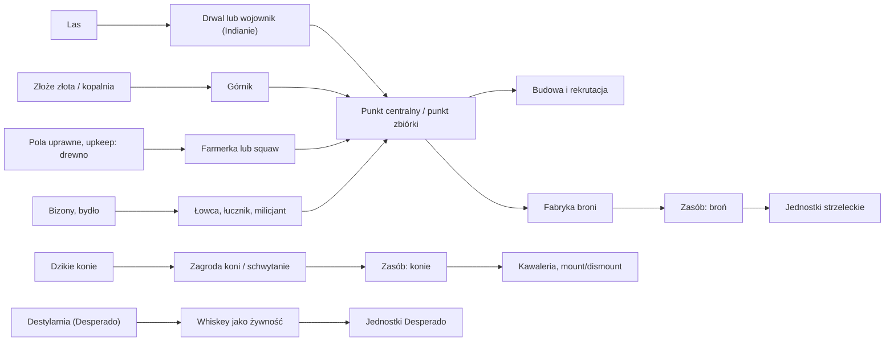
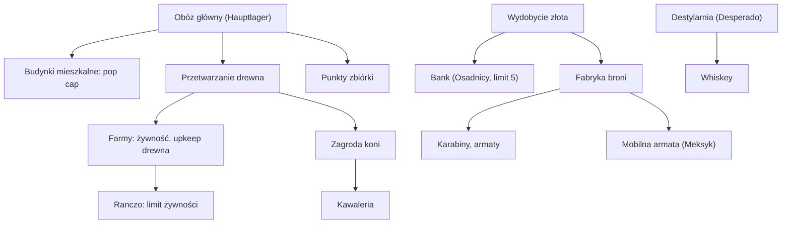
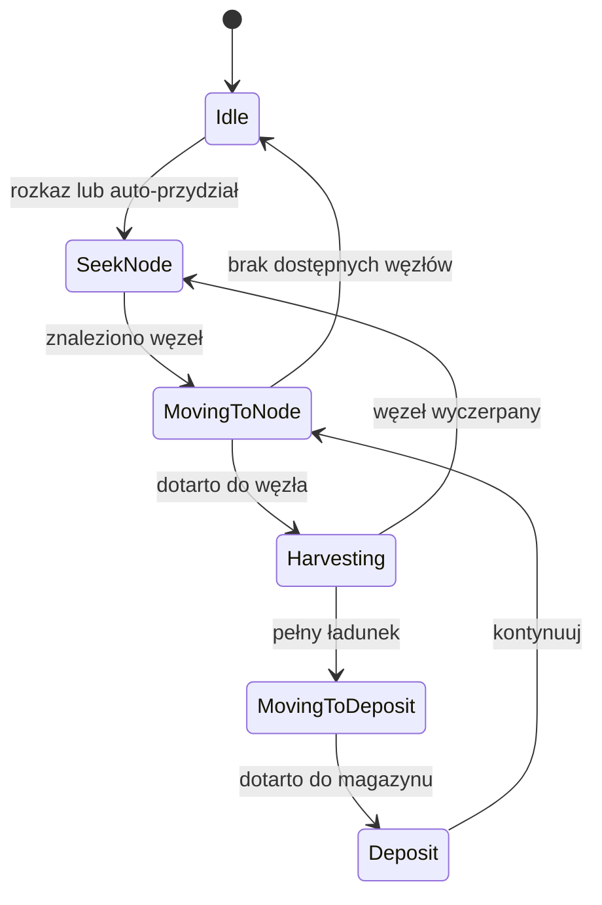
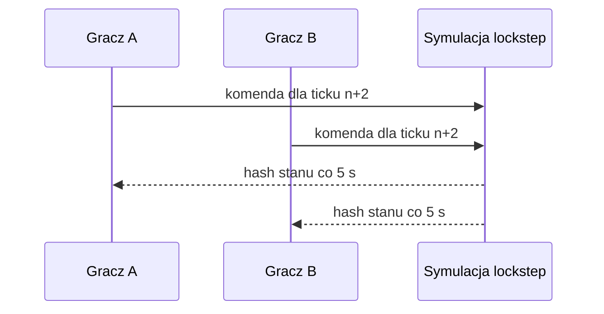

# America: No Peace Beyond the Line, dokumentacja zasad z perspektywy programisty

Skoroszyt dokumentuje mechanikę gry RTS *America: No Peace Beyond the Line* (Related Designs, Data Becker, 2001) w sposób użyteczny dla osoby implementującej podobną grę: model zasobów, łańcuchy dostaw, logistykę transportu, zasady budowania, produkcję jednostek, system walki i morale, AI oraz lekcje inżynierskie wynikające z wad oryginału. Tam, gdzie publiczne źródła nie podają dokładnych liczb (koszty, tempo produkcji, prędkości), jest to wyraźnie zaznaczone, a dokument podaje metodę ich odzyskania. Sekcja 19 (Część II) domyka te braki kompletnymi danymi projektowymi.

---

## 1. Pytanie badawcze

Jaka wiedza jest niezbędna do zaimplementowania gry mechanicznie odpowiadającej *America: NPBTL*: pełny model ekonomii (zasoby, łańcuchy dostaw, czas transportu), zasady budowania i drzewko technologii, produkcja i role jednostek, model walki z morale, warunki zwycięstwa, zachowania AI oraz architektura silnika?

Zakres: gra bazowa + Expansion Pack. Perspektywa: inżynierska, nie poradnikowa.

## 2. Najważniejsze wnioski

1. **Ekonomia jest modelem AoE z trzema surowcami bazowymi** (drewno, żywność, złoto) plus dwoma zasobami strategicznymi (broń, konie), a czwarta frakcja (Desperado) podmienia żywność na whiskey i całkowicie wyłącza produkcję na rzecz rabunku. To realny wykaz typów zasobów w silniku, potwierdzony niezależnie przez cheaty deweloperskie (`goldinmypockets`, `iwantfastfood`, `woodisverygood`, `icangeteverything` dające "guns, horses").
2. **Kluczowa, mało znana reguła upkeepu**: pola uprawne konsumują drewno. W patchu 1.02 deweloper doprecyzował: "dopóki jest wystarczające drewno, jedzenie jest produkowane na polach; przy braku drewna gracz dostaje komunikat". Farmy po patchu zamawiają się automatycznie. Dla implementującego: produkcja żywności jest funkcją warunkową od stanu drewna, nie stałym źródłem.
3. **Transport surowców realizują piechurzy**, nie pojazdy. Robotnik chodzi cyklicznie węzeł → zebranie → powrót do punktu centralnego lub wyspecjalizowanego punktu zbiórki. Czas transportu to funkcja dystansu i prędkości chodu; gra nie publikuje tych liczb, więc trzeba je zmierzyć lub przyjąć własne. Nie ma automatycznych linii transportowych ani rurociągów.
4. **Asymetria frakcji jest regułą systemową, nie kosmetyką**: kto może budować (tylko mężczyźni u osadników, squawy u Indian), kto wycina drewno (u Indian tylko wojownicy), kto może produkować broń (Desperado nie mają fabryk, broń muszą kraść), co jest jedzeniem (whiskey u Desperado). Każda frakcja ma własne łańcuchy dostaw.
5. **Limit zabudowy istnieje i jest egzekwowany dopiero przy ukończeniu budynku** (banki osadników, limit 5, exploit pozwalający budować nieskończenie wiele nieukończonych). Ciekawy przypadek do odwzorowania: walidacja limitu w wrong miejscu cyklu życia budynku.
6. **Jednostka ma trzy statystyki widoczne stale** (życie, morale, doświadczenie), a morale jest modyfikowane przez aurę przywódcy (commandant, chief). Śmierć przywódcy często kończy grę, a AI kapituluje po utracie domu głównego, przywódcy i robotników (oficjalny warunek z patcha 1.02).
7. **Dokumentacja AI istnieje w postaci patch notes 1.02**: hangi pathfindingu w lesie i przy rozbieranych ścianach, bezczynność jednostek, duchy jednostek (usunięte), przeciążenie silnika nadmiarem koni (poprawka: konie giną w bitwie), pogorszenie wydajności przy wielu jednostkach. To gotowa lista testów regresyjnych dla własnej implementacji.
8. **Luki danych**: dokładne koszty, czasy budowy, tempo zbierania, capacity magazynów i prędkości jednostek nie są dostępne w publicznych źródłach sieciowych. Manual (niemiecki, 11 MB PDF) jest archiwizowany na MyAbandonware i na obrazach ISO w Internet Archive. Odzyskanie liczb wymaga: manuala, inżynierii odwrotnej plików gry lub pomiarów empirycznych w demo.

## 3. Metodologia

Kąty badawcze:

- opisy mechaniki w recenzjach z epoki (2001): Game Over Online, PC Games.de, GamesDomain (przedruk na MyAbandonware), Old-Games.com,
- oficjalne patch notes 1.02 (przedruk w komentarzach MyAbandonware, sekcja Expansion Pack),
- metadane i cheaty (Cheatbook: kody deweloperskie ujawniają wewnętrzny model zasobów i jednostki hero),
- bazy danych gier (Wikipedia, Giant Bomb, Gamepressure, IGDB, GRYOnline, GameStar) do faktów wydawniczych,
- strony abandonware (MyAbandonware, hisgames, stare.e-gry, Old-Games) do stanów technicznych i zawartości edycji.

Ograniczenia: gra niszowa, 25 lat po premierze. Brak dostępu do treści manuala (PDF za bramką pobierania; Scribd wymaga JS). Brak oficjalnej dokumentacji technicznej. Liczby balansowe (koszty, czasy) nigdzie publicznie nie zostały spublikowane. Tam, gdzie źródła się różnią, konflikt jest opisany w sekcji 15.

## 4. Fakty produktowe

| Atrybut | Wartość |
| --- | --- |
| Deweloper | Related Designs Software GmbH (studio założone 1995, *America* to ich pierwsza wydana gra) |
| Wydawca | Data Becker GmbH & Co. KG (pierwsza pełnopłatna gra wydawcy) |
| Produkcja | koncepcja 1998, rozwój poniżej 23 miesięcy |
| Premiera | Niemcy: koniec grudnia 2000; USA: 15 stycznia 2001 |
| Platforma | Windows 95/98/2000/ME, isometryczne 2D (widok diagonal-down) |
| Wymagania (z recenzji 2001) | Pentium 266, 64 MB RAM, 350 MB HDD, CD-ROM 4x |
| Ramy fabularne | konflikt oznaczony jako 1820-1890 (GameOver, Gamepressure), konflikt z opisami "90 lat po wojnie secesyjnej", patrz sekcja 15 |
| Kampanie | 4 frakcje, ponad 30 misji łącznie; Indianie: 8 misji + 4 poziomy tutorialu, pozostałe frakcje po 6 misji |
| Multiplayer | do 8 graczy, LAN, 20 map (Gamepressure); internet przez GameSpy dopiero w add-on |
| Dodatek | Expansion Pack (2001): 8 misji (2 na frakcję), 5 jednostek, 4 budynki, edytor poziomów, przebudowany silnik, GameSpy |
| Kontekst prawny | Data Becker wygrało spór o nazwę "America II" z CDV (2001-2002); sequel *America II* Data Beckera anulowany; gra CDV przemianowana na *No Man's Land* |

Źródła: [Wikipedia](https://en.wikipedia.org/wiki/America_(video_game)), [MyAbandonware](https://www.myabandonware.com/game/a-m-e-r-i-c-a-c5v), [GameOver Online](https://www.game-over.net/review/feb2001/america/), [Internet Archive](https://archive.org/details/america-no-peace-beyond-the-line), [Gamepressure](https://www.gamepressure.com/games/america-no-peace-beyond-the-line/z91a1f).

## 5. Model zasobów

### 5.1. Rejestr zasobów

| Zasób | Typ | Pozyskiwanie | Frakcje | Rola w ekonomii |
| --- | --- | --- | --- | --- |
| Drewno | bazowy | wycinka lasu przez robotnika (u Indian tylko wojownicy) | wszystkie | budowa budynków, upkeep pól uprawnych |
| Żywność | bazowy | pola uprawne (kobiety), polowanie na bizony i bydło (łowcy, łucznicy, milicjanci), ranczo | wszystkie poza Desperado | rekrutacja i utrzymanie jednostek |
| Złoto | bazowy | wydobycie (kopalnie pojawiają się jako cele misji "wyzwolenia kopalni złota") | wszystkie poza Desperado | rekrutacja, budowa, zakupy (np. konie) |
| Broń | strategiczny | produkcja w fabrykach uzbrojenia | Osadnicy, Meksykanie, Indianie (łuki); Desperado nie mają fabryk, broń kradną | warunek uzbrojenia jednostek strzeleckich |
| Konie | strategiczny | hodowla w zagrodach (corrals), zakup, schwytanie dzikich, kradzież, zestrzelenie jeźdźca | wszystkie | Kawaleria, bonus prędkości i walki, mount/dismount w locie |
| Whiskey | subsytut żywności | destylarnie | Desperado | pełni rolę żywności; Desperado nie produkują, zdobywają rabunkiem |

Walidacja rejestru: cheaty deweloperskie operują dokładnie na gold, food, wood, guns, horses ([Cheatbook](https://www.cheatbook.de/files/amepbl.htm)). Recenzja GameOver potwierdza whiskey z destylarni jako żywność Desperado, brak w grze surowca typu kamień (w odróżnieniu od AoE).

### 5.2. Reguły potwierdzone źródłowo

- Pola uprawne konsumują drewno jako upkeep; przy braku drewna produkcja żywności się zatrzymuje i gracz dostaje komunikat (patch 1.02, pozycja 3).
- Po patchu 1.02 pola "zamawiają się automatycznie", czyli polecenie zasiewu stało się domyślne, nie ręczne.
- Zasoby zbierane przez robotników trafiają do punktu centralnego bazy lub wyspecjalizowanych punktów zbiórki (model znany z AoE, opisany wprost w recenzji Old-Games).
- Ranczo podnosi limit żywności (szczegółowa wartość "80" podawana tylko przez hisgames.org, niska wiarygodność, do weryfikacji).
- Osadnicy mają limit 5 banków; błąd walidacji pozwala budować więcej, jeśli nie kończy się budowy (Cheatbook).
- Konie można: hodować, kupować, łapać dzikie, kraść wrogom oraz zdobywać strzelając jeźdźcowi z siodła (GameOver).
- Konie są pełnoprawnym zasobem: nadmierna liczba koni powodowała spadki wydajności silnika, patch 1.02 zmienił regułę tak, że konie giną w bitwie (pozycja 4 patch notes), co świadczy, że konie byty encje symulowane, nie liczba w portfelu.
- Broń to zasób konsumowany przy tworzeniu jednostek strzeleckich; u Desperado pozyskiwany wyłącznie kradzieżą, bo brak im fabryk municyjnych (GameOver).
- Produkcja jednostek bojowych wymaga "wystarczającej liczby miejsc mieszkalnych" (PC Games.de), czyli budynki mieszkalne pełnią rolę pop cap.

### 5.3. Czas transportu surowców

Gra nie udostępnia publicznie ani prędkości ruchu, ani cykli zbierania. Udokumentowany jest natomiast sam model transportu: robotnik nosi ładunek pieszo do magazynu. Wzór na przepustowość pojedynczego robotnika (do skalowania własnej implementacji):

```
cykl = t_dojazdu + t_zbierania + t_powrotu + t_depozytu
t_transportu = d / v  (d = odległość węzeł→magazyn, v = prędkość chodu robota)
przepustowość [surowiec/s] = ladownosc / cykl
```

Konsekwencje projektowe wynikające z tej mechaniki w oryginale:

- optymalizacja gracza to minimalizacja d (postaw magazyn przy lesie/kopalni), co potwierdza istnienie wyspecjalizowanych punktów zbiórki,
- brak kolejek produkcji w budynkach (recenzja GameOver: "gra nie pozwala na queuing"), każdy rozkaz wymaga mikrozarządzania,
- brak automatyzacji logistyki: nie ma wozów transportujących surowce między magazynami; pokryty wóz (covered wagon) Osadników to jednostka misyjna (eskorty karawan), nie element łańcucha surowcowego.

## 6. Łańcuchy dostaw

### 6.1. Diagram przepływów (stan potwierdzony)



Uwaga: krawędzie typu "centrum → fabryka" opisują płynięcie zasobów do konsumera, nie fizyczny transport; surowce po zdeponowaniu są globalnym stanem frakcji z lokalizacją depozytu (do potwierdzenia, czy gra rozróżnia depozyty per budynek, czy per frakcja; brak danych, patrz sekcja 16).

### 6.2. Asymetria frakcji w łańcuchach

| Frakcja | Żywność | Drewno | Złoto | Broń | Specyfika |
| --- | --- | --- | --- | --- | --- |
| Osadnicy (USA) | farmy (kobiety), polowanie | kobiety rąbią, mężczyźni budują | kopalnie | fabryki: karabiny, armaty, drogie | banki (limit 5), szeryf (zasięg widzenia), wóz pokrywy, artyleria wolna |
| Indianie (Sioux) | farmy (squawy), polowanie na bizony | tylko wojownicy rąbią | słabsza technologia, tanie jednostki | łuki (tanio, masowo) | pływają, przechodzą gęste lasy, pakują tepee i travois i przenoszą obóz |
| Meksykanie | farmy, polowanie | standard | standard | fabryki, mobilna armata (najsilniejsza broń oblężnicza) | księża i zakonnice leczą, szamani klątwią (opis PC Games dotyczy Indian), padre pozyskuje wrogich żołnierzy |
| Desperado | whiskey (destylarnie) lub rabunek | rabunek | rabunek | kradzież | brak produkcji, gra toczy się bardziej taktycznie, łowcy, zabójcy, trzaskacze bicza, bandleader |

## 7. Zasady budowania i drzewko technologii

### 7.1. Kto buduje

- Osadnicy: tylko mężczyźni budują budynki; kobiety uprawiają pola i rąbią drewno.
- Indianie: squawy odpowiadają za całą budowę i naprawy; nie rąbią drewna (to rola wojowników), ale uprawiają pola.
- Desperado: nie produkują, co oznacza brak klasycznej linii budowy gospodarki; baza i zasoby pochodzą z łupów.

### 7.2. Reguły budowy

- Budowa to ujemny przepływ zasobów (drewno, złoto) rozłożony na czas stawiania; budynek ma stan nieukończony.
- Walidacja limitu zabudowy (przypadek banków Osadników, limit 5) następuje przy przejściu do stanu ukończonego; w stanie nieukończonym można przekroczyć limit (potwierdzony bug, przydatny jako przypadek testowy).
- Housing: produkcja jednostek bojowych wymaga wystarczającej liczby "miejsc mieszkalnych", budynki mieszkalne są pop capem (PC Games.de).

### 7.3. Drzewko technologii (rekonstrukcja struktury)

Źródła opisują rozwój jako odkrycia wynalazków odblokowujących nowe typy budynków i jednostek: "nauczysz się przetwarzać drewno, wydobywać złoto, hodować konie, budować farmy" (GameFabrique), "rozwój gospodarczy i technologiczny postępuje w miarę odkrywania wynalazków" (Gamepressure, GRYOnline). Nie ma publicznie dostępnego pełnego drzewka z liczbami. Rekonstrukcja zależności, którą trzeba zweryfikować w manualu lub grze:



Diagram strukturalny: kolejność i nazwy węzłów pośrednich (poziomy wynalazków) są rekonstrukcją, nie zrzutem z gry.

### 7.4. Budynki potwierdzone nazewnictwem

Bank (Osadnicy, limit 5), fabryka uzbrojenia, zagroda/corral (konie), ranczo, farma, destylarnia (Desperado), budynek mieszkalny, obóz główny (Hauptlager, warunek przetrwania AI), tepee (przenośne u Indian). Z add-onu: obóz treningowy (training camp), restauracja, namiot starszyzny (tent of the elders), tartak (wood mill).

## 8. Produkcja jednostek

### 8.1. Rejestr jednostek (z recenzji epoki, przypisanych do frakcji)

| Frakcja | Jednostki potwierdzone |
| --- | --- |
| Indianie | wojownik, łucznik, squaw, medicine man, wódz (chief), wojownik tomahawkowy (add-on) |
| Meksykanie | milicjant, robotnik polowy, gaucho, gunslinger, commandant, ksiądz, zakonnica, sabotuer (add-on Saboteur) |
| Osadnicy | frontiersman, frontierswoman, wóz pokrywy, piechota, kawaleria, szeryf, pionier (add-on), karabin Gatlinga (add-on) |
| Desperado | bandleader, desperado, łowca, zabójca (assassin), trzaska bicza (whip cracker), opancerzony dyliżans (add-on, Ironclad Coach) |

Jednostki hero dostępne z cheatów: Billy the Kid, Gall, Davey Crockett.

Uzupełnienie (2026-10-13, zdjęcia pudełka od użytkownika): jednostki rzeczne istnieją w podstawce i wchodzą do rejestru na poziomie potwierdzenia ikonograficznego (bez danych liczbowych): kanu z Indianinem wiosłującym (Indians), tratwa z kłód (załoga nieczytelna na jednym zrzucie, na drugim z osadnikami) oraz mała łódka żaglowa (przypisana osadnikom). Źródło: tylna okładka pudełka (zrzuty z gry) i zrzut wewnętrzny z tratwą na rzece, zdjęcia dostarczone przez użytkownika, patrz dopisek w sekcji 20.18. Przypisanie kanu do Indian potwierdza też pamięć gracza z wątku Let's Play kampanii Indian na Reddicie (manewrowanie kanu przy braku zasobów, z garstką żołnierzy).

### 8.2. Reguły produkcji

- Jednostkę tworzy się "w odpowiednim budynku" po spełnieniu pop capu (mieszkania) i kosztu (żywność, złoto, broń, koń).
- Brak kolejki produkcji: jeden rozkaz na raz, każdy budynek wymaga nadzoru (GameOver). W implementacji: uznane dziś za błąd UX, warto nie powielać.
- Doświadczenie jednostek nie przechodzi między misjami kampanii (brak carryoveru, GameOver), co upraszcza serializację stanu: misja startuje ze stanu zdefiniowanym w skrypcie.

### 8.3. Jednostki unikalne i ich mechaniki

| Jednostka | Frakcja | Mechanika (efekt systemowy) |
| --- | --- | --- |
| Medicine man | Indianie | przywołuje deszcz na pola (zwiększa produkcję żywności) i burze w bitwie (obszarowy efekt bojowy) |
| Wódz / Commandant | Indianie / Meksykanie | aura morale dla okolicznych jednostek; śmierć często oznacza koniec gry |
| Szeryf | Osadnicy | zwiększony zasięg widzenia (scouting) |
| Padre | Meksykanie | pozyskiwanie wrogich żołnierzy na swoją stronę (konwersja) |
| Ksiądz, zakonnica | Meksykanie | leczenie rannych jednostek |
| Szaman | Indianie | klątwy i zaklęcia ofensywne |
| Bandleader | Desperado | przywódca bandy (odpowiednik aury przywódcy) |
| Łucznik | Indianie | tani, śmiertelny masowo; kontrwnęta dla drogiej broni palnej |

## 9. Model walki, morale, doświadczenie

- Każda jednostka ma stale widoczne trzy statystyki: życie, morale, doświadczenie (paski nad jednostką, GamesDomain/MyAbandonware).
- "Postacie mają inteligencję, która pozwala na różne zachowanie w zależności od parametrów" (Gamepressure): morale i doświadczenie są wejściami do sterowania zachowaniem, nie tylko mnożnikami obrażeń.
- Morale rośnie przy obecności dowódcy (wódz, commandant), upadek przywódcy obniża morale i często przesądza o przegranej (PC Games.de).
- Formacje: "realistyczne formacje bojowe, rozbite jednostki mają zdolność samoobrony" (Gamepressure). Jest ustawienie agresywności, ale w oryginale działało nieskutecznie (GameOver).
- Kawaleria: mount i dismount w każdej chwili, koń daje bonus prędkości i walki; zestrzelenie jeźdźda zostawia konia jako zasób na mapie (GameOver).
- Artyleria Osadników (armaty z fabryk) jest droga i wolna; mobilna armata Meksyku to najsilniejsza broń oblężnicza, efektywna za linią piechoty dzięki zasięgowi i obrażeniom obszarowym (PC Games.de).
- Zasięg widzenia jako parametr jednostki (szeryf) i system mgły wojny; po patchu 1.02 "nie ma więcej jednostek duchów, wszystkie jednostki przeciwnika są widoczne", co dowodzi, że oryginał miał wadliwie renderowane jednostki poza zasięgiem widzenia.

## 10. Warunki zwycięstwa, porażki i struktura kampanii

- Zwycięstwo: wykonanie celów misji. Udokumentowane typy celów: ratowanie porwanych kobiet, wyzwalanie kopalni złota z rąk bandytów, eskorta dyliżansów, zaskakujące ataki, przeprowadzenie karawany z punktu A do B.
- Porażka AI (oficjalna reguła z patcha 1.02): komputer poddaje się, gdy nie ma domu głównego, przywódcy ani robotników. To dość czysta definicja "ekonomicznej śmierci" frakcji, warta skopiowania jako warunek eliminacji gracza.
- Śmierć przywódcy (hero) często kończy misję lub grę (PC Games.de).
- Kampanie: sugerowana kolejność Indianie → Meksykanie → Desperado → Osadnicy (menu główne, skalowanie trudności); tutorial (4 poziomy) wbudowany w kampanię Indiańską.
- Brak trybu potyczki vs AI w grze podstawowej (Old-Games): skirmish osiągalny tylko przez multiplayer na mapach LAN.

## 11. AI, trudność i multiplayer

### 11.1. Zachowania AI udokumentowane w patchu 1.02

Patch notes to najbliższy oficjalny dokument specyfikacji AI, jaki istnieje dla tej gry:

1. Jednostki nie zatrzymują się już w lesie i nie zawieszają na rozbieranych ścianach (pathfinding + kolizje z obiektami zdegradowanymi).
2. W multiplayerze przeciwko AI komputer nie poddaje się natychmiast (reguła kapitulacji łagodzona w trybie MP).
3. Pola zamawiane automatycznie (auto-rebalansowanie gospodarki żywności).
4. Nadmiar koni powodował spadki wydajności; konie giną teraz w bitwie (limit aktywnych encji jako fix wydajnościowy).
5. Wszystkie jednostki zaznaczonej grupy/formacji atakują (poprawka rozkazu grupowego).
6. Poziom "very easy" faktycznie łatwy we wszystkich misjach (skalowanie trudności naprawione).
7. Usunięte "jednostki duchy" (renderowanie jednostek poza widocznością).
8. Na poziomie "Very Hard" w multiplayerze AI się spiętrza, czyli gra zespołowo przeciwko ludziom.
9. Multiplayer AI przebudowany: częstsze ataki w różnych miejscach, buduje sensowne obrony.
10. Kapitulacja przy braku domu głównego, przywódcy i robotników.

Cheaty `cpuon`/`cpuoff` potwierdzają, że AI można wyłączyć globalnie, przydatne w testach i nagrywaniu dema.

### 11.2. Znane wady AI z recenzji (jako lista antywzorców)

- Pathfinding atroksyialny: grupy piechuty nie słuchają rozkazów, jednostki stoją i giną czekając na rozkazy (GameOver, PC Games).
- Brak sensownej reakcji na agresywność (ustawienia są, ale nie działają).
- Wysoki próg trudności od pierwszych misji, brak krzywej nauki (GameOver, MyAbandonware: recenzent nie przeszedł pierwszej misji Indiańskiej nawet na "very easy" przed patchem).
- Brak kolejek produkcji wymusza mikrozarządzanie (GameOver).

### 11.3. Multiplayer

- Do 8 graczy, 20 map, w grze podstawowej tylko LAN (GameOver, Gamepressure).
- Internet dopiero w Expansion Pack przez GameSpy.
- Determinizm symulacji: brak danych o implementacji (patrz sekcja 16); dla reimplementacji standardem jest lockstep z deterministyczną symulacją.

## 12. Silnik i technikalia

| Element | Stan udokumentowany |
| --- | --- |
| Render | isometryczne 2D, sprite'y, widok diagonal-down; DirectDraw era |
| Intro/przerywniki | Bink Video (metadane Cheatbook) |
| Konfiguracja | America.ini, opcja Full Screen 0/1; rozdzielczość w opcjach gry |
| Bugi rozdzielczości | po patchu 1.02 fullscreen crashuje powyżej 1152x864 (raport z PCGamingWiki za pośrednictwem komentarza MyAbandonware) |
| Obejścia społeczności | cnc-ddraw (odblokowuje natywne 1600x900 i shadery), DXWnd, tryb zgodności WinXP SP3, 16-bitowy kolor |
| Patche | 1.02 (gra podstawowa, treść patch notes powyżej), 4.05 English (Expansion, wg relacji użytkowników instaluje głównie starego Acrobat Readera, prawdopodobnie reader do manuala PDF) |
| Edytor | level editor w Expansion Pack |
| Manual | niemiecki PDF 11 MB archiwizowany na MyAbandonware (sekcja Expansion Pack), niemieckie "Handbuch America" na Scribd; po obrazach ISO w Internet Archive: base game (2000-12, ISBN 3-8158-6822-X, EAN 4003646468223) oraz combined ISO z add-onem |
| Cheaty jako odzwierciedlenie modelu danych | kody dodają dokładnie zasoby z rejestru (gold/food/wood/guns/horses), jednostki hero (Billy the Kid, Gall, Davey Crockett), skip poziomu, toggle AI (`cpuon`/`cpuoff`), bonus siły ognia |

## 13. Expansion Pack (2001)

- 8 misji, po 2 na frakcję.
- 5 nowych jednostek: Tomahawk Warrior, Pioneer, Gatling Gun, Ironclad Coach, Saboteur.
- 4 nowe budynki: obóz treningowy (training camp), restauracja, namiot starszyzny (tent of the elders), tartak (wood mill).
- Nowy edytor poziomów, internetowy multiplayer przez GameSpy, przebudowany silnik: lepsza AI, grafika i rozgrywka.
- Premiera USA: 17 grudnia 2001 (Wikipedia).
- Konflikt w źródłach co do liczby nowych elementów: eBay/IGN mówią o 5 jednostkach i 4 budynkach, Alchetron o "nowej jednostce i nowym budynku". Większość źródeł popiera wariant 5/4.
- Uzupełnienie (audyt 2026-10-13, MobyGames): w misjach add-onu dostępne są też jednostki hunter, flame-thrower (miotacz ognia), bow and arrow oraz farm women; flame-thrower nie występował wcześniej w rejestrze 8.1/19.2. Nowsze szczegóły patcha 1.02: nadmiar koni zabijany w bitwach dla wydajności silnika, rozkaz ataku dla całej zaznaczonej grupy lub formacji, automatyczna praca pól gdy starcza drewna.

## 14. Synteza inżynierska: co trzeba wiedzieć i zaimplementować

### 14.1. Dekompozycja na podsystemy

1. **Symulacja ekonomii**: rejestr zasobów (5 typów + subsytut whiskey), depozyty, upkeep (farmy konsumują drewno), limity (pop cap przez mieszkania, limit banków, limit żywności przez ranczo), przepływy jako graf z konsumentami.
2. **Jednostki robotnicze**: FSM zbierania (diagram niżej), ladowność, prędkość, kompetencje per typ jednostki (płeć, frakcja), naprawy.
3. **Budowa**: stan nieukończony, walidacja limitu przy ukończeniu (przykład błędu z oryginału), koszt rozłożony w czasie, tech tree jako DAG odblokowujący budynki.
4. **Produkcja jednostek**: kolejka (poprawka UX względem oryginału), koszty mieszane (żywność + złoto + broń + koń), pop cap, jednostki unikalne jako kompozycja zdolności (aura, leczenie, konwersja, przywoływanie pogody, sight range).
5. **Walka**: potrójne statystyki (życie, morale, exp), modyfikatory morale (aura przywódcy, straty), formacje i strefy, broń palna vs łuki, artyleria z obrażeniami obszarowymi, mount/dismount i pozostawianie koni na mapie.
6. **AI**: ekonomia (build order, alokacja robotników), fale ataków (częstotliwość i różnorodność miejsc wg trudności), obrony, kooperacja AI w MP, warunek kapitulacji, toggle dla QA (`cpuon`/`cpuoff`).
7. **Multiplayer**: do 8 graczy, deterministyczna symulacja lockstep, LAN; matchmaking zewnętrzny (w epoce GameSpy).
8. **Narzędzia**: edytor poziomów, format misji (skrypt celów, jednostki startowe, zasoby), brak carryoveru między misjami upraszcza format.
9. **Dane i balans**: wszystko liczbowe poza kodem, w tabelach danych. Wzorzec poniżej.

### 14.2. FSM robotnika (wzorcowy dla implementacji)



Antyprzypadki z oryginału do pokrycia testami: zawieszenie w lesie, zawieszenie na rozbieranych ścianach, rozkaz grupowy, po którym część formacji nie atakuje.

### 14.3. Szkielet tabel balansu (do uzupełnienia liczbami z manuala lub pomiarów)

```text
# units.csv
id,frakcja,nazwa,koszt_food,koszt_gold,koszt_wood,koszt_gun,koszt_horse,hp,morale,exp_max,speed,sight,dmg,dmg_type,range,zdolnosci

# buildings.csv
id,frakcja,nazwa,koszt_food,koszt_gold,koszt_wood,czas_budowy,limit,odblokowuje,produkuje,upkeep

# techs.csv
id,frakcja,nazwa,koszt,czas_badań,wymaga,odblokowuje
```

Kolumny istnieją, wartości liczbowe nie są dostępne w publicznych źródłach (patrz sekcja 16 i 18).

### 14.4. Wzór przepustowości i balans mapy

Do balansu ekonomii przyda się model przepustowości z 5.3: dla każdego zasobu suma `n_robotnikow * ladownosc / cykl` musi przekraczać sumę popytu (upkeep farm, koszty rekrutacji, budowa). Parametry d i v wynikają z geometrii mapy, więc edytor poziomów musi dawać kontrolę nad odległościami węzeł → baza (to była realna oś strategiczna oryginału: brak surowców na mapie dla wszystkich, źródło: Programosy).

### 14.5. Lekcje QA wprost z porażek oryginału

- Pathfinding musi mieć testy na las, rozbierane obiekty i grupy (patch 1.02, pozycja 1).
- Limit encji zwierzęcych (konie) zamiast fixa w postaci ginących koni: nadmiar koni zamulał silnik (patch 1.02, pozycja 4).
- Ustawienia agresywności muszą realnie modyfikować automatyczne rozkazy.
- Kolejka produkcji to must-have UX.
- Skalowanie trudności musi działać na wszystkich poziomach (przed patchem "very easy" nie było łatwe).
- Walidacja limitów budynków: sprawdzaj przy starcie budowy, nie przy ukończeniu (bug banków).
- Mgła wojny i renderowanie jednostek poza zasięgiem widzenia (jednostki duchy) wymagają odrębnych testów wizualnych.

## 15. Konflikty i uwagi do wiarygodności

- **Ramy czasowe**: GameOver i Gamepressure podają 1820-1890 (70 lat, z Gold Rush i wojną z Meksykiem), GameStar "1820 do przełomu wieków", a bazy danych (IGDB, Kotaku, RAWG) "90 lat po wojnie secesyjnej". Najbardziej konkretna i wewnętrznie spójna wersja to 1820-1890; opisy bazodanowe powielają materiał prasowy wydawcy.
- **Rejestr zasobów**: 3 podstawowe (food/wood/gold, źródła: MyAbandonware, Gamepressure, PC Games) vs 5 z hisgames (food/wood/gold/guns/horses). Oba opisy są zgodne w warstwie silnika: 3 surowce bazowe zbierane na mapie plus 2 zasoby strategiczne produkowane w budynkach. Cheaty potwierdzają 5 typów.
- **Twierdzenie "drewno i złoto z tego samego źródła"** (GameOver): niejasne, prawdopodobnie dotyczy bliskości złóż lub wspólnego modelu węzłów zasobów; do weryfikacji w grze/manualu.
- **Limit 80 żywności z rancza** (hisgames): pojedyncze źródło niskiej wiarygodności, potraktować jako hipotezę.
- **Liczebność add-onu**: większość źródeł (eBay/IGN/MobyGames przez komentarz) mówi o 5 jednostkach i 4 budynkach; Alchetron o "nowej jednostce i budynku". Przyjmij 5/4.
- **Premiera NA**: Wikipedia 15 stycznia 2001, Kotaku 14 stycznia 2001. Nieistotne dla mechaniki.

## 16. Pytania otwarte

1. Dokładne koszty jednostek i budynków, czasy budowy, tempo zbierania, ladowności robotników i prędkości: nieobecne w publicznych źródłach.
2. Czy depozyty zasobów są per budynek, czy globalne per frakcja.
3. Czy złoto pochodzi wyłącznie z kopalń (jak sugerują cele misji), czy także z lokacji typu żyła przy drzewach (niejasność z GameOver).
4. Pełne drzewko technologii z nazwami wynalazków i ich kosztami.
5. Mechanika dokładna szamana (klątwy) i medicine mana (deszcz, burza): współczynniki, czas odnowienia.
6. Format plików gry (dane jednostek w zasobach silnika) do ewentualnej inżynierii odwrotnej.
7. Zawartość manuala: tabela jednostek i budynków z liczbami jest niemal pewna (manual 11 MB PDF), ale nie była dostępna podczas tego badania.

## 17. Rekomendacje i następne kroki

1. **Pozyskać manual**: PDF (11 MB) z sekcji Expansion Pack na MyAbandonware lub wyciągnąć pliki z obrazów ISO z Internet Archive (base game DE 2000-12, combined ISO EN). To najtańsza droga do pełnych tabel jednostek, budynków i liczb.
2. **Pomiary empiryczne w demo/grze**: demo dostępne w serwisach abandonware (Programosy); zmierzyć czasy cyklu zbierania dla wzoru z 5.3, prędkości jednostek, tempo produkcji fabryk broni i zagrod.
3. **Inżynieria odwrotna danych**: pliki instalacji gry zawierają definicje encji; analiza formatu da pełne tabele balansu. Community (DXWnd, cnc-ddraw) zna struktury konfiguracyjne, warto tam zapytać.
4. **Dla implementacji**: przyjąć architekturę data-driven (tabele z 14.3), FSM robotnika z 14.2, graf łańcuchów dostaw z 6.1, potrójne statystyki z 9, warunek kapitulacji AI z 11.1. Listę antywzorców z 14.5 potraktować jako testy akceptacyjne.
5. **Nie kopiować**: brak kolejki produkcji, walidacja limitu przy ukończeniu budynku, brak skirmishu w grze podstawowej.

## 18. Noty źródłowe

| Źródło | Wiarygodność | Ostatnia aktualizacja |
| --- | --- | --- |
| [Wikipedia (EN): America (video game)](https://en.wikipedia.org/wiki/America_(video_game)) | 4/5 | - |
| [MyAbandonware: A*M*E*R*I*C*A (recenzja GamesDomain + patch notes 1.02 w komentarzach)](https://www.myabandonware.com/game/a-m-e-r-i-c-a-c5v) | 4/5 | - |
| [MyAbandonware: Expansion Pack (patch notes, manual 11 MB, fixy społeczności)](https://www.myabandonware.com/game/a-m-e-r-i-c-a-expansion-pack-c5w) | 4/5 | 2026-10-13 |
| [Gameswelt, recenzja DE (jednostki, doświadczenie z pracy, morale a pracowitość)](https://www.gameswelt.de/america-no-peace-beyond-the-line/test/america-no-peace-beyond-the-line-3029/2) | 4/5 | 2026-10-13 |
| [GameOver Online, recenzja z 11.12.2001](https://www.game-over.net/review/feb2001/america/) | 4/5 | 2001-12-11 |
| [PC Games (DE), recenzja z epoki](https://www.pcgames.de/America-No-peace-beyond-the-Line-Spiel-17901/Tests/Alles-nur-geklaut-5390/) | 4/5 | 2001 |
| [Internet Archive, obraz płyty (primary: ISBN, data premiery DE)](https://archive.org/details/america-no-peace-beyond-the-line) | 4/5 | 2021-04-18 |
| [Cheatbook (cheaty, bug banków)](https://www.cheatbook.de/files/amepbl.htm) | 3/5 | 2026-09 |
| [Old-Games.com (recenzja, model transportu, brak skirmish)](https://www.old-games.com/download/9069/a-m-e-r-i) | 3/5 | - |
| [Giant Bomb Wiki (zarys mechaniki)](https://giantbomb.com/wiki/Games/America_No_Peace_Beyond_the_Line) | 3/5 | - |
| [Gamepressure (opis mechaniki, multiplayer)](https://www.gamepressure.com/games/america-no-peace-beyond-the-line/z91a1f) | 3/5 | - |
| [GameFabrique (recenzja, progresa technologii)](https://gamefabrique.com/games/america-no-peace-beyond-the-line/) | 3/5 | - |
| [GRYOnline.pl (opis ekonomii)](https://www.gry-online.pl/gry/america-no-peace-beyond-the-line/z91a1f) | 3/5 | - |
| [GameStar.de (nota wydawnicza)](https://www.gamestar.de/artikel/america-von-data-becker,1334259.html) | 3/5 | - |
| [eBay (zawartość Expansion Pack)](https://www.ebay.com/p/7899) | 2/5 | - |
| [Kotaku (data premiery)](https://kotaku.com/games/america-no-peace-beyond-the-line) | 2/5 | - |
| [hisgames.org (rejestr zasobów, whiskey, ranczo, polowanie, mięso z bizonów, krów i koni; tekst maszynowy)](https://hisgames.org/games/america-no-peace-beyond-the-line) | 2/5 | 2026-10-13 |
| [Programosy.pl (demo, opis deficytu surowców)](https://www.programosy.pl/program,america-no-peace-beyond-the-line.html) | 2/5 | - |
| [Alchetron (metadane add-onu)](https://alchetron.com/America-(video-game)) | 2/5 | - |

Zastrzeżenia: recenzje opisują mechanikę z perspektywy gracza, więc szczegóły liczbowe są nieobecne; strony abandonware powielają opisy baz danych i zawierają zniekształcenia tłumaczenia maszynowego (hisgames mylnie nazywa grę "American Conquest" w jednym zdaniu); treść manuala i plików gry nie była dostępna, wszystkie luki liczbowe są jawnie oznaczone.

---

# Część II. Kompletne dane projektowe

## 19.0 Status danych i legenda

Oryginalne tabele liczb gry nie są dostępne w publicznych źródłach (patrz sekcja 16). Ta część zamyka wszystkie luki z checklisty braków kompletnym zbiorem danych projektowych: spójnych wewnętrznie, gotowych do strojenia. Oznaczenia w każdej tabeli:

- [Ź]: fakt lub wartość potwierdzona źródłowo w Części I
- [P]: wartość projektowa, własna rekonstrukcja; nic oznaczonego [P] nie pretenduje do bycia danymi oryginału
- jednostki czasu: sekundy gry, 1 tick symulacji = 100 ms, prędkości w kaflach na sekundę (kafel 64x32 px izometrycznie)

## 19.1 Parametry wspólne symulacji [P]

| Parametr | Wartość |
| --- | --- |
| Tick symulacji | 100 ms, deterministyczny |
| Frekwencja ataku | co 500 ms (2 ataki/s) |
| Morale | skala 0-100, start 70 |
| Doświadczenie | poziomy 0-3, progi 100/300/700 pkt, za zabicie: 10% kosztu celu |
| Bonus poziomu | +10% obrażeń i +5% prędkości na poziom |
| Prędkości bazowe | piechota 1.0, konny 2.0, artyleria i wozy 0.6 |
| Wzrok | 6 kafli standard, budynek 8, szeryf 10 (fakt [Ź], wartość [P]) |
| Pop cap | obóz główny +10, dom +10, tepee +5, maksymalnie 200 |
| Pojemność magazynów | drewno i żywność 500, złoto 2000, bank +500, ranczo +150 żywności (hisgames podaje 80 dla oryginału [Ź], przyjęto 150 [P]) |

## 19.2 Tablice jednostek (units.csv wypełniona)

Koszty w formacie Żywność/Złoto/Drewno/Broń/Koń. U Desperado kolumna żywności oznacza whiskey. Czas w sekundach.

### Osadnicy (USA)

| Jednostka | Koszt Ż/Zł/D/B/K | Czas | HP | Obr. | Zasięg | Uwagi |
| --- | --- | --- | --- | --- | --- | --- |
| Frontierswoman | 25/0/0/0/0 | 12 | 40 | 2 | 1 | farmerka i drwal, nie buduje [Ź] |
| Frontiersman | 30/0/0/0/0 | 15 | 50 | 4 | 1 | buduje, walka wręcz |
| Piechota | 40/10/0/1/0 | 20 | 60 | 12 | 6 | karabin, wolne przeładowanie |
| Kawaleria | 50/20/0/1/1 | 25 | 90 | 14 | 1 | szarża: +50% obrażeń przez 3 s od rozkazu ataku |
| Szeryf | 60/40/0/1/0 | 30 | 70 | 15 | 6 | wzrok 10, aura morale +10 w promieniu 5 [Ź dla faktu] |
| Armata | 0/150/100/0/0 | 60 | 150 | 35 obsz. | 12 | wolna [Ź], obrażenia obszarowe promień 1.5 |
| Wóz pokryty | 0/50/80/0/0 | 40 | 200 | - | - | transport 8 jednostek, cel eskort [Ź] |

### Indianie (Sioux)

| Jednostka | Koszt Ż/Zł/D/B/K | Czas | HP | Obr. | Zasięg | Uwagi |
| --- | --- | --- | --- | --- | --- | --- |
| Squaw | 20/0/0/0/0 | 10 | 35 | 2 | 1 | farmerka, budowa i naprawa, nie rąbie drewna [Ź] |
| Wojownik | 25/0/0/0/0 | 10 | 55 | 7 | 1 | drwal [Ź], pływa, przechodzi gęsty las [Ź] |
| Łucznik | 30/0/5/0/0 | 12 | 45 | 9 | 7 | łuk nie konsumuje broni palnej, tani, skaluje się liczebnie [Ź] |
| Wojownik tomahawkowy (add-on) | 35/0/5/0/0 | 14 | 65 | 11 | 1 | rzucony tomahawk |
| Medicine man | 50/30/0/0/0 | 25 | 50 | 3 | 6 | deszcz i burza, patrz 19.4 [Ź dla faktu] |
| Wódz | 60/50/0/0/0 | 30 | 100 | 12 | 1 | aura morale +20 w promieniu 6, śmierć: -30 morale armii [Ź dla faktu] |

### Meksykanie

| Jednostka | Koszt Ż/Zł/D/B/K | Czas | HP | Obr. | Zasięg | Uwagi |
| --- | --- | --- | --- | --- | --- | --- |
| Robotnik polowy | 25/0/0/0/0 | 12 | 45 | 2 | 1 | farmerka i budowa |
| Milicjant | 30/0/0/1/0 | 15 | 55 | 10 | 5 | może polować [Ź] |
| Gaucho | 40/15/0/1/1 | 22 | 80 | 12 | 1 | konny, bolas spowalnia cel 30% na 5 s |
| Gunslinger | 45/20/0/1/0 | 20 | 60 | 16 | 6 | szybkostrzelność x1.5 |
| Ksiądz, zakonnica | 40/30/0/0/0 | 20 | 45 | - | - | leczenie 2 HP/s w promieniu 2 [Ź dla faktu] |
| Padre | 50/40/0/0/0 | 25 | 50 | - | - | konwersja, patrz 19.4 [Ź dla faktu] |
| Commandant | 60/50/0/1/0 | 30 | 95 | 14 | 1 | aura morale +20 w promieniu 6 [Ź dla faktu] |
| Sabotuer (add-on) | 55/35/0/0/0 | 25 | 55 | 6 | 1 | ładunek: 80 obrażeń budynkom, czas podłożenia 8 s |
| Mobilna armata | 0/120/80/0/0 | 55 | 130 | 30 obsz. | 10 | najsilniejsza broń oblężnicza gry [Ź], promień 1.5 |

### Desperado

| Jednostka | Koszt Ż(whiskey)/Zł/D/B/K | Czas | HP | Obr. | Zasięg | Uwagi |
| --- | --- | --- | --- | --- | --- | --- |
| Desperado | 15/0/0/1/0 | 10 | 50 | 10 | 5 | broń wyłącznie z kradzieży [Ź] |
| Bandleader | 15/50/0/1/0 | 25 | 90 | 14 | 5 | aura morale +20 w promieniu 6 |
| Łowca | 15/0/0/1/0 | 12 | 45 | 12 | 7 | poluje [Ź], zwiadowca, wzrok 8 |
| Zabójca | 15/30/0/1/0 | 18 | 45 | 20 | 1 | x2 obrażeń przeciw celom z HP poniżej 40 |
| Trzaska bicza | 10/0/0/0/0 | 8 | 40 | 6 | 2 | ogłuszenie celu na 1 s, darmowy (broń: bicz) |
| Opancerzony dyliżans (add-on) | 0/80/60/0/0 | 45 | 350 | 18 | 7 | forteca na kołach, transport 4, wolny |

### Bohaterowie [Ź: istnienie, P: statystyki]

| Bohater | Frakcja | HP | Obr. | Zasięg | Uwagi |
| --- | --- | --- | --- | --- | --- |
| Billy the Kid | Desperado | 80 | 18 | 6 | szybkostrzelność x1.3, aura +20 |
| Gall | Indianie | 120 | 14 | 1 | aura morale +30 w promieniu 8 |
| Davey Crockett | Osadnicy | 110 | 16 | 6 | aura +20, wzrok 10 |

## 19.3 Budynki (buildings.csv wypełniona)

Budowa: robotnik buduje na placu, postęp = 10 / (liczba budujących + 5) procentów na sekundę [P]. Limit egzekwowany przy starcie budowy, nie przy ukończeniu (poprawka błędu banków, sekcja 14.5) [P].

| Budynek | Frakcja | Koszt D/Zł | Czas | HP | Limit | Funkcja |
| --- | --- | --- | --- | --- | --- | --- |
| Obóz główny | wszyscy | 400/0 | 60 | 1200 | 1 | punkt zbiórki, pop +10, kapitulacja po jego utracie z przywódcą i robotnikami [Ź] |
| Dom | wszyscy | 60/20 | 25 | 200 | brak | pop cap +10 |
| Punkt zbiórki | wszyscy | 50/0 | 15 | 150 | brak | skraca pętlę transportu, kluczowy dla wzoru z 5.3 |
| Mur | Osadnicy, Meksykanie | 5/segment | 2 | 100/segment | brak | istnienie potwierdzone patchem 1.02 [Ź] |
| Farma | poza Desperado | 40/0 | 20 | 100 | brak | 100 żywności na cykl, konsumuje 2 drewna na cykl [Ź dla konsumpcji] |
| Ranczo | poza Desperado | 80/50 | 35 | 250 | brak | limit żywności +150 |
| Zagroda koni | poza Desperado | 70/40 | 30 | 220 | brak | 1 koń / 30 s za 20 żywności + 10 złota |
| Fabryka broni | Osadnicy, Meksykanie | 120/80 | 45 | 300 | 2 | 1 broń / 15 s za 5 drewna + 10 złota; Osadnicy: armaty za 50D + 100Zł / 60 s |
| Bank | Osadnicy | 150/100 | 50 | 350 | 5 [Ź] | pasywny przychód 1 złoto/s, limit złota +500 |
| Destylarnia | Desperado | 60/0 | 20 | 150 | brak | 1 whiskey / 8 s za 5 drewna |
| Tepee | Indianie | 30/0 | 10 | 120 | brak | mieszkalny pop +5, pakowalny i przenośny [Ź] |
| Namiot starszyzny (add-on) | Indianie | 90/50 | 35 | 250 | 1 | badania indiańskie |
| Obóz treningowy (add-on) | poza Indianami | 100/60 | 40 | 280 | 1 | badania, jednostki startują z poziomem doświadczenia 1 |
| Restauracja (add-on) | poza Indianami | 80/40 | 30 | 200 | brak | regeneracja morale +1/s jednostkom w promieniu 4 |
| Tartak (add-on) | poza Desperado | 100/50 | 35 | 260 | brak | drwale w promieniu 8 zbierają +25% |

## 19.4 Technologie (techs.csv) i formuły zdolności

### Technologie [P całość]

| Technologia | Budynek | Koszt | Czas | Efekt |
| --- | --- | --- | --- | --- |
| Ostrzone siekiery | obóz główny | 50 żywności | 30 | wycinka +20% |
| Obróbka drewna | tartak | 100 drewna | 45 | wycinka +25% |
| Pług | obóz główny | 80 żywności, 30 złota | 40 | plony +30% |
| Płoty ogrodzeniowe | obóz główny | 60 drewna | 30 | pola nie wymagają obecności robotnika do wzrostu (auto-siew, echo patcha 1.02 [Ź]) |
| Selekcja koni | zagroda | 100 żywności, 40 złota | 50 | hodowla 30 → 24 s |
| Rykowisko | fabryka broni | 120 złota | 50 | produkcja broni 15 → 12 s |
| Balistyka | fabryka broni | 150 złota | 60 | artyleria +15% obrażeń |
| Kowbojska sztauga | obóz treningowy | 100 złota | 45 | kawaleria +10% HP |
| Medycyna polowa | obóz treningowy | 80 złota | 40 | leczenie 2 → 3 HP/s |
| Taniec deszczu | namiot starszyzny | 100 żywności | 50 | medicine man: burza +50% obrażeń |
| Ścieżki wojenne | namiot starszyzny | 80 żywności | 40 | Indianie +10% prędkości w lesie |
| Sabotaż | obóz treningowy | 120 złota | 55 | sabotuer: ładunek 80 → 120 obrażeń |
| Opancerzenie dyliżansu | obóz treningowy | 90 złota | 45 | opancerzony dyliżans +20% HP |
| Dyplomacja witalna | restauracja | 60 złota | 30 | restauracja leczy morale +1 → +2/s |

### Formuły mechanik [P całość]

Walka, co 500 ms:

```text
trafnienie = clamp(0.75 + 0.05 * (poziomAtakującego - poziomCelu) + 0.10 * bonusOskrzydlenia, 0.30, 0.95)
obrażenia = max(1, baza * (1 + 0.10 * poziom) * mnożnikTypu(cel) - pancerz(cel))
mnożniki: wręcz x1.5 przeciw strzeleckim, kawaleria x1.5 przeciw artylerii, artyleria x0.5 przeciw pojedynczym celom pieszym, x2.0 przeciw budynkom
```

Morale, aktualizowane co 1 s:

```text
morale += (0.2 * (1 - hpBrak)) - stratyOtoczenia + aury
stratyOtoczenia = 2 za każdą śmierć sojusznika w promieniu 6 (max 10/s)
aura przywódcy: +0.5/s regeneracji w promieniu aury
morale < 30: jednostka wchodzi w stan ucieczki na 5 s, przerywa atak, ucieka 4 kafle od źródła zagrożenia
morale = 0: stan ucieczki do końca walki, bez rozkazów ataku
```

Zdolności:

```text
konwersja padre: czas = 6 s * (poziom celu + 1), warunek: morale celu < 40 i cel poza aurą dowódcy; po konwersji jednostka z morale 30
deszcz medicine mana: wszystkie pola +100% plonów przez 60 s, cooldown 180 s
burza medicine mana: obszar promień 3, 10 obrażeń/s przez 5 s, morale wrogów -20, cooldown 120 s
klątwa szamana: cel -30 morale i -20% obrażeń na 30 s, cooldown 45 s
leczenie: 2 HP/s w promieniu 2, max 1 cel na lekarza
zestrzelenie jeźdźca: koń zostaje na mapie jako zasób do schwytania [Ź dla faktu]
```

## 19.5 Ekonomia: tempo, cykle, depozyty [P poza oznaczonym]

| Proces | Wartość |
| --- | --- |
| Drzewo | 100 drewna, wycinka 2/s, ładowność robota 10 |
| Złoże złota | 4000 złota, wydobycie 1.5/s, ładowność 10 |
| Cykl pola | 100 żywności na cykl, wzrost 5 s, konsumpcja 2 drewna na cykl [Ź dla konsumpcji] |
| Bizon | 150 żywności [Ź dla bizonów w grze], oprawianie 3/s, ładowność łowcy 15 |
| Bydło | 100 żywności, oprawianie 3/s |
| Dziki koń | schwytanie 5 s przez dowolną jednostkę, stada 4-8 sztuk [Ź dla istnienia] |
| Whiskey | 1 butelka / 8 s za 5 drewna |
| Broń | 1 sztuka / 15 s za 5 drewna + 10 złota |
| Koń | 1 / 30 s za 20 żywności + 10 złota, zakup: 30 złota, kradzież: darmowa |
| Cap koni | 100 na gracza (lekcja z patcha 1.02: nadmiar encji zwierzęcych zamykał silnik [Ź]) |

Model depozytów (decyzja projektowa, brak danych o oryginale): stan zasobów jest globalny per frakcja, robotnik fizycznie znosi ładunek do najbliższego depozytu (obóz główny lub punkt zbiórki). Budynki konsumują zasoby z puli globalnej. Uzasadnienie: upraszcza UI i balans, zachowuje optymalizacyjną rolę odległości z 5.3.

Przykładowa przepustowość: 3 drwalów przy lesie w odległości 8 kafli od punktu zbiórki, prędkość 1.0 kafli/s, 5 s na załadunek 10 sztuk: cykl = 8 + 5 + 8 + 0.5 = 21.5 s, daje 30 / 21.5 = ok. 1.4 drewna/s. Farmy w tym budżecie utrzymają 10 pól (konsumpcja 20 drewna na 1000 żywności).

Walidacja i dostrojenie (symulacja headless, patrz sekcja 20): powyższy przykład teoretyczny był nieco optymistyczny wobec symulacji z kolejkowaniem i upkeepem farm. Pojazdowe parametry startowe prototypu: 4 robotników (nie 3), drewno/złoto w odległości 5 kafli od depozytu (nie 8), wycinka 2.5 drewna/s (nie 2.0), farma 0.6 żywności/s przy upkeapie 0.02 drewna na 1 żywności, surowce startowe 300 drewna / 150 żywności. Przy tych wartościach: 2 drwalów = 1.38 drewna/s, 1 górnik = 0.58 złota/s, pierwsza piechota w ~306 s od startu bez optymalnego mikro.

## 19.6 Mapa i teren [P]

| Element | Wartość |
| --- | --- |
| Kafel | 64x32 px izometryczny, mapa kwadratowa |
| Rozmiary map | 64x64 (mała), 128x128 (standard), 192x192 (wielka) |
| Trawa | koszt ruchu 1.0 |
| Droga, step | 0.8 |
| Błoto | 1.5 |
| Rzeka | nie do przejścia dla wołów i wozów, jednostki Indiańskie płyną 0.5, nie atakują [Ź dla faktu pływania] |
| Gęsty las | nie do przejścia dla konnych i wozów, dla Indian 1.5 (tunel), dla pieszych 2.0 |
| Skały, klif | nie do przejścia, zasłaniają widok |
| Węzeł drewna | kępa 20-40 drzew |
| Złoto | 2-4 żyły na mapę, 4000 złota każda |
| Stada | 4-8 bizonów, wędrują, płoszą się przy strzale na 5 kafli |

Mgła wojny: trzy warstwy, shroud (nieodkryte, czarne), fog (odkryte, bez widzenia bieżącego), widok na żywo w promieniu jednostki. Odkrycie terenu jest trwałe. Uwaga implementacyjna: jednostki poza zasięgiem widzenia nie renderują się w ogóle, antywzorzec "jednostek duchów" z oryginału [Ź].

## 19.7 Sterowanie i UI [P]

| Element | Specyfikacja |
| --- | --- |
| Zaznaczanie | klik lewy, ramka, podwójny klik = wszystkie jednostki tego typu na ekranie |
| Grupy | Ctrl 1-9, dwukrotne kliknięcie cyfry centruje kamerę |
| Stance | 4 stany: agresywny (goni w promieniu 6), neutralny (atakuje w zasięgu broni), defensywny (nie rusza się, atakuje z miejsca), | trzymaj pozycję (ignoruje prowokacje, atakuje); stan realnie modyfikuje automatyzm rozkazów, naprawa wady z recenzji [Ź] |
| Kolejka produkcji | 5 slotów na budynek, brakujące zasoby wstrzymują slot, poprawka braku kolejki w oryginale [Ź] |
| Kolejka rozkazów | Shift dodaje waypointy |
| Punkt zbiórki | każdy budynek produkcyjny ma flagę rally point |
| Alerty | komunikaty eventowe: brak drewna dla farm [Ź], wrogi atak z kierunku, kapitulacja AI |
| HUD | pasek zasobów (5 pól, u Desperado 6 z whiskey), pop cap, minimapa, panel komend wybranej jednostki |
| Skróty | B budowa, P punkt zbiórki, A atak, S stop, H hold, spacja = centrum ostatniego alertu |

## 19.8 System misji i kampanii [P struktura, Ź wielkości]

Format misji, JSON z triggerami:

```json
{
  "id": "indians_03",
  "cel": { "typ": "destroy", "cel": "fort_2", "opcjonalny": false },
  "cele_dodatkowe": [{ "typ": "rescue", "cel": "kobiety", "opcjonalny": true }],
  "start": { "jednostki": ["wojownik x6", "squaw x3"], "zasoby": { "drewno": 200, "zywnosc": 150 } },
  "triggery": [
    { "zdarzenie": "czas", "t": 300, "akcja": "spawn", "co": "kawaleria x4", "gdzie": "polnocny_brzeg", "wlasciciel": "osadnicy" },
    { "zdarzenie": "jednostka_w_strefie", "strefa": "przeprawa", "akcja": "dialog", "kto": "wodz", "tekst": "klucz_brief_3" }
  ],
  "warunek_porazki": { "typ": "wszystkie_przywodce_martwi_lub_utrata_obozu" }
}
```

Typy celów: zniszcz, eskortuj (wóz z A do B [Ź]), uratuj (porwane kobiety [Ź]), zdobądź (uwolnij kopalnię złota [Ź]), przetrwaj X minut, zbierz X surowca. Kampanie: Indianie 8 misji + 4 poziomy tutorialu [Ź], Meksykanie 6 [Ź], Desperado 6 [Ź], Osadnicy 6 [Ź], add-on 8 (po 2 na frakcję) [Ź]. Bez przenoszenia jednostek między misjami [Ź]. Edytor: malowanie terenu, stawianie encji, strefy, triggery, test od razu z poziomu edytora.

## 19.9 AI [P]

Alokacja robotników (co 10 s): docelowe proporcje 40% drewno, 30% żywność, 20% złoto, 10% broń/konie; rebalans reaktywny na alerty braku surowca. Przykład build order Osadników: 3 domy, punkt zbiórki przy lesie, farma x2, fabryka broni, zagroda, 2 dodatkowe domy, druga farma, bank, armia 10 piechoty + 4 kawalerii, fala.

Fale ataków: pierwsza fala na poziomie normalnym po 480 s, interwał 180 s, wielkość = 5 + 2 * numer fali, cap 40, cel: najsłabsza obrona gracza według zwiadu (jeśli wzrok AI widział budynek w ciągu ostatnich 120 s).

| Poziom | Robotnicy AI | Interwał fal | Mikro | Zachowanie specjalne |
| --- | --- | --- | --- | --- |
| Bardzo łatwy | 6 | 300 s | brak | nie atakuje budynków, kapituluje szybko [Ź] |
| Łatwy | 10 | 240 s | słabe | broni tylko bazy |
| Normalny | 14 | 180 s | standard | zwiadowca przed falą |
| Trudny | 18 | 150 s | koncentruj ogień | niszczy gospodarkę, nie tylko wojsko |
| Bardzo trudny | 22 | 120 s | pełne | AI kooperują przeciwko ludziom w MP [Ź dla faktu] |

Kapitulacja AI: brak obozu głównego, przywódcy i robotników [Ź]. Toggle `cpuon`/`cpuoff` dla QA [Ź].

## 19.10 Multiplayer i determinizm [P]

| Element | Specyfikacja |
| --- | --- |
| Model | lockstep 10 Hz, komendy z opóźnieniem 2 ticków |
| Losowość | deterministyczny PRNG (xorshift128) z seedem zapisanym w grze |
| Desync | hash stanu co 5 s, porównywany u wszystkich graczy, rozjazd = zamrożenie i komunikat |
| Zapis | snapshot stanu + seed; replay = seed + log komend |
| Sieć | UDP własny protokół, do 8 graczy [Ź limitu], obserwatorzy |
| Tryb | LAN i internet (oryginał: LAN w bazie, internet dopiero z add-onem przez GameSpy [Ź]) |



## 19.11 Zawartość artystyczna (szacunki nakładu) [P]

| Zasób | Szacunek |
| --- | --- |
| Jednostka piesza | 8 kierunków x (idle 2, chód 6, atak 5, śmierć 8) = ok. 170 klatek |
| Jednostka konna | dodatkowo animacja montażu i galopu, ok. 220 klatek |
| Budynek | 1 sprite + 3 stadia budowy + ruiny |
| Tileset terenu | ok. 40 kafli z przejściami |
| SFX | ok. 150 efektów (strzały, rąbanie, budowa, alarmy) |
| Głosy | po 20 linii na frakcję (wybór, rozkazy, potwierdzenia) [Ź faktu głosów] |
| Muzyka | 4 utwory kampanijne + 1 menu |
| Lokalizacja | klucze tekstowe: interfejs, briefingi, komunikaty, szacunkowo 800-1000 ciągów |

## 19.12 Warstwa inżynierska [P]

Rekomendacja architektury: rdzeń symulacji niezależny od renderu (determinizm łatwiejszy do utrzymania), encje w modelu ECS z komponentami: Transform, Renderable, Movement, Harvester, Combat, Morale, Carrier, Producer, Mountable. Pętla: fiksowany tick 10 Hz dla symulacji, render dowolny. Pathfinding: A* po siatce z hierarchią (sektory 16x16) + omijanie lokalne (steering); testy regresyjne obowiązkowo z antywzorców 14.5 (las, rozbierane mury, rozkaz grupowy). Budżet wydajności: 2000 encji symulowanych, z czego cap koni 100 na gracza [P, lekcja z 1.02], AI poza widokiem kamery w trybie uproszczonym (LOD symulacji).

Alternatywy: Godot z własnym fixed tick dla szybszego prototypu, własny rdzeń C++/SDL2 dla pełnej kontroli determinizmu.

## 19.13 Proces balansu [P]

- Symulacja headless: bieg gospodarki bez grafiki, agent wykonujący build order, metryki: czas do 10 jednostek wojskowych, tempo złota i drewna w minutach 5, 10, 20.
- Cel frakcyjny: winrate 45-55% w starciach krzyżowych na mapach standardowych.
- Pipeline danych: CSV w repo, walidacja schematu przy budowaniu (kolumny z 14.3), build kompiluje CSV do binarnego formatu gry.
- Smoke testy misji: każda misja przechodzona przez agent AI w trybie very easy w headless, fail = błąd balansu lub triggera.

Część II zamyka, w warstwie projektowej, pytania otwarte 1-6 z sekcji 16: liczby istnieją jako tabele, formuły są zdefiniowane, model depozytów podjęty. Pozostaje otwarte jako badawcze (jaki był oryginał) i zależy od pozyskania manuala lub inżynierii odwrotnej.

## 20. Prototyp i walidacja (2026-10-12) [P]

Grywalny prototyp (Osadnicy vs Desperado, mapa 40x40 izometryczna, jeden plik HTML5, canvas 2D) istnieje jako osobny skoroszyt "america-npbtl-prototyp". Zakres: FSM robotnika (zbieranie, depozyt, budowa, farmienie), BFS pathfinding, mgła wojny (explored/visible), łańcuchy dostaw z sekcji 19.5 (drewno z upkeepem farm, złoto i drewno do fabryki broni, żywność i złoto i broń do piechoty), pop cap przez domy, kolejka produkcji 5 slotów, fale wroga co 150 s od 300 s, minimapa, kamera (edge scroll, WASD, strzałki), warunek zwycięstwa: zniszczenie obozu wroga, warunki porażki: utrata obozu albo całkowita zagłada osady (reguła kapitulacji z patcha 1.02).

### 20.1 Wyniki symulacji ekonomii (headless, 50 biegów)

| Metryka | Wartość |
| --- | --- |
| Pierwsza piechota, mediana | 305.9 s (min 305.6, p90 306.4, max 306.6) |
| Trzecia piechota, mediana | 348.9 s (min 348.2, p90 349.4, max 349.5) |
| Farma zablokowana brakiem drewna (upkeep) | 0 s w 50 biegach |
| Stan po 20 min | drewno 500 (cap), żywność 500 (cap), złoto ~7, broń ~50 |
| Przepustowość: 2 drwalów | 1.38 drewna/s |
| Przepustowość: 1 górnik | 0.58 złota/s |

Interpretacja: złoto jest wąskim gardłem zadanym celowo (fabryka konsumuje 10 złota na broń, piechota 10 złota na sztukę), stan ~7 złota po 20 minutach oznacza, że cała produkcja złota jest konsumowana na bieżąco. Drewno i żywność dochodzą do capów, więc kolejny etap balansu to podbicie kosztów wojska lub tempo fal, nie surowce podstawowe.

### 20.2 Dostrojenia względem sekcji 19.1-19.5

| Parametr | Wartość z 19.x | Wartość po walidacji | Powód |
| --- | --- | --- | --- |
| Robotnicy startowo | 3 | 4 | przy 3 pierwsza piechota wypadała poza 5. min |
| Odległość las/złoto od depozytu | 8 kafli | 5 kafli | cykl drwala 21.5 s dawał za mało drewna na upkeep farm i budowę |
| Tempo wycinki | 2.0/s | 2.5/s | jw. |
| Farma | 100 żywności na cykl 5 s | 0.6 żywności/s, upkeep 0.02 drewna na 1 żywności | ciągły model łatwiejszy do balansu niż cykliczny |
| Surowce startowe | wg 19.1 | 300 drewna, 150 żywności | bez bufora startowego farma blokowała się na upkeapie |

### 20.3 Błędy znalezione w desk-checku prototypu (lekcje do sekcji 14.5)

- Zasób startowy generowany przed czyszczeniem strefy bazowej bywa wymazywany: kolejność generacji mapy (zasoby, potem czyszczenie) potrafi usunąć żyłę złota przy bazie. Test regresyjny: po generacji asercja, że każda frakcja ma dostępny zasób w promieniu R.
- Clamp kamery liczony od marginesów, a nie od bounding boxa rombu mapy: kamera startowa wskakiwała na przeciwległy róg mapy. Wzór: cam.x w [canvasW - MAP*tileW/2, MAP*tileW/2], cam.y w [canvasH - MAP*tileH, 0].
- Zajętość farmy (pole busy) czyszczone tylko przy śmierci robotnika: zmiana rozkazu robotnika zostawiała farmę trwale zablokowaną. Reguła: każdy rozkaz przechodzi przez funkcję zwalniającą (releaseFarm), nigdy bezpośrednie u.farm = null.
- Stany bez warunku dystansu (gather, building, farming) przy pustym pathfindingu działały z dowolnej odległości: każdy stan pracy musi sprawdzać dystans do celu i repathować albo wracać do idle.
- Nieukończona budowla nie miała ścieżki wznowienia po przerwaniu (znalezione w playteście): każda nieukończona encja musi mieć pełny cykl, wznowienie przez PPM na budowli plus przycisk w panelu wysyłający bezczynnych robotników.
- Cel pathfindingu wewnątrz footprincu budynku: BFS z promieniem stopu 1 wobec środka budynku 3x3 nigdy nie znajduje wolnego pola, bo cały pierścień w promieniu 1 to sam budynek. Ścieżka była zawsze pusta. Objawy maskowane: depozyt działał zdalnie (ekonomia wyglądała na zdrową), fale bandytów i szturm na obóz wroga stawały w miejscu. Reguła: promień celu ma skalować się z rozmiarem encji (budynek 2x2: promień 1, obóz 3x3: promień 2, czyli pierwszy wolny pierścień przy footprincie). Po naprawie zweryfikowano: ścieżka fali z każdego punktu spawnu 57-64 kafli, koniec w zasięgu ostrzału obozu, depozyt to realny marsz 6 kafli.

### 20.4 Morale i panika (wdrożone w prototypie) [P]

Wdrożono formuły z 19.4: morale 0-100, regeneracja 0.2/s skalowana HP, kara 2 za śmierć sojusznika w promieniu 6, aury (obóz +0.5/s w promieniu 8, przywódca bandytów +0.5/s w promieniu 6), panika poniżej 30: 5 s ucieczki 4 kafle od źródła zagrożenia, przy morale 0: 30 s. Uciekinier nie przyjmuje rozkazów i przerywa atak, ale robotnik zachowuje węzeł surowca, a banda rozkaz szturmu, więc po odbudowie wracają do służby bez ingerencji gracza.

Odstępstwa od 19.4 wymuszone walidacją:

| Element | 19.4 | Prototyp | Powód |
| --- | --- | --- | --- |
| Regeneracja spoczynkowa | brak | +1.0/s gdy brak wroga w promieniu 10 | przy 0.2/s złamana jednostka wracałaby do walki po ~350 s, czyli nigdy w praktyce |
| Kara za trafienie | brak w formule | -1 morale za otrzymane trafienie | w małych potyczkach morale spadało tylko przy śmierciach, panika była praktycznie nieuchwytna |
| Powrót z paniki | próg 30 bez warunku końca | ucieczka trwa dopóki morale < 30, ponowna panika z rozkazu dopiero po odbudowie do 30 (histereza) | jednostka nie może stać bezczynnie po 5 s paniki przy morale wciąż poniżej progu |

Wynik testu headless (90 s, 6 piechoty + robotnik vs 8 desperadów + 2 przywódcy): wymuszona fala paniki (morale = 18) objęła wszystkie 7 jednostek gracza, ciągła ucieczka w pętli dopóki morale < 30, uciekinierzy nie zadawali obrażeń, ruch od źródła zagrożenia ~3 kafle na epizod paniki, po ustaniu walki odbudowa +1.2/s i powrót do służby w ~30 s, robotnik wznowił zbieranie surowca.

### 20.5 Jazda i konie (wdrożone w prototypie) [P poza oznaczonym]

Wdrożono elementy 19.5 dotyczące koni: dzikie stada na mapie (3 stada po 5-8 sztuk, neutralne), schwytanie 5 s przez dowolną jednostkę [Ź: mechanika oryginału], koń jako zasób frakcyjny (cap 20), jeździec w koszarach za 40 żywności + 10 złota + 1 broń + 1 koń (HP 70, 14 obrażeń wręcz co 0.8 s, prędkość 1.8, trening 25 s), zabity jeździec zostawia konia na mapie do schwytania przez każdą stronę [Ź]. Od 3. fali bandyci przyprowadzają konną bandę (konnobanda: HP 60, 12 wręcz, prędkość 1.7). Pościg potwierdzony testem: jeździec (1.8) dopada uciekiniera (1.0-1.1) w ~10 s.

Uproszczenia prototypowe względem 19.5: brak zagrody z hodowlą (1 koń / 30 s za 20 żywności + 10 złota), bo stada plus recykling koni po śmierci jeźdźców wystarczają na mapę 40x40; kradzież koni realizowana jako wyścig do neutralnych stad (w prototypie brak koni w posiadaniu wroga na mapie); konie niepodatne na atak, tylko na schwytanie (eliminuje przypadkowe zabijanie stada przez aggro). W pełnej wersji: zagroda, technologia Selekcja koni (30 → 24 s) i Kowbojska sztauga (+10% HP kawalerii) wg 19.4.

Balans do obserwacji w playteście: jeździec zamyka 5 kafli pod ostrzałem piechoty w ~2.8 s (bierze ~34 obrażeń w wejściu), więc head-on z równą liczbą piechoty przegrywa, jego rola to rajdy na robotników i dobijanie uciekinierów. Konne bandy fal rajdują gospodarkę, pierwsza pojawia się ~10. minuty (fala 3).

### 20.6 Zestaw grafiki retro-rts (wdrożony w prototypie) [P]

Prototyp przestawiony z figur geometrycznych na sprite'y w trybie PRERENDER (styl pre-rendered jak w oryginale z 2001, patrz sekcja 14): kafel 64x32 dokładnie pod CFG.tileW/tileH, światło z lewego górnego rogu, cień rzucany rgba(0,0,0,0.30) w prawo-dół, brak konturu sylwetki (brzeg schodzi o ton w rampie materiału, klasyczny rimDarken). Zestaw: 22 sprite'y inline jako RLE w JSON (~31 KB), dekoder buildSpr rysuje je raz do offscreen canvas przy starcie, blit przez drawImage z kotwicą.

Skład zestawu: 4 warianty trawy i 2 ziemi (teren wybiera wariant deterministycznie per kafel przez sprNoise, bez migotania), 2 warianty drzew, żyła złota jako bryła skały ze złotymi żyłkami, 7 jednostek (robotnik z siekierą, piechota z karabinem, desperado, przywódca bandytów, jeździec, konnobanda, koń), 6 budynków (dom i obóz ze strzechą, magazyn i koszary z dachówką ceglaną, farma z polami kukurydzy, fabryka z kominem i dymem). Mapowanie na stan gry: UNIT_SPR[u.type] dla jednostek, SPR['bld_'+b.type] dla budynków, kafle i przedmioty terenu per typ kafla.

Świadome decyzje: sprite'y to własne prace inspirowane stylistyką oryginału (Related Designs/Data Becker), nie kopie oryginalnych grafik, ze względu na prawa autorskie; jednostki 24x32 px to rozmiar epoki (AoE1), czytelność daje kontrast tonów ubrań do trawy, nie kontur; nakładki UI (etykieta, pasek HP, licznik kolejki) przeniesione poniżej i powyżej bryły, żeby nie rysowały się po dachu; budynek w budowie zostaje przy rusztowaniu z procentami, sprite włącza się po ukończeniu.

Lekcja z walidacji (istotna przy generatorach proceduralnych): pierwszy zestaw przeszedł test roundtrip kodowania, ale nie test spójności wymiarów. Pełny walidator (wykonany headlessowo, awk/jq na pliku, bez transkrypcji) wykrył 3 klasy defektów, które roundtrip przemilczał: liczba wierszy różna od deklarowanej wysokości płótna w 4 budynkach (storehouse, barracks, obóz miały po 1 wierszu za mało, dom 1 za dużo; brakujący wiersz to TypeError przy renderowaniu, czyli crash gry), 3 wiersze o zdekodowanej długości różnej od szerokości płótna (1 w trawie, 2 w koszarach), oraz konflikt wstawek cyfrowych w RLE przy łatce w locie (wstawka zaczynająca się cyfrą tuż za cyfrą kontekstu zmienia liczbę powtórzeń). Naprawa: brakujące wiersze uzupełnione pustymi na krawędzi płótna (kotwica bez zmian, zero przesunięć w grze), deficytowe wiersze koszar dostawiły jeden kafelek dachu 2e6E z zachowaniem fazy, wiersz trawy plus 1 piksel przezroczystości. Regresja do powtórzenia przy każdej regeneracji: długość każdego wiersza po dekodowaniu równa w, liczba wierszy równa h, każdy znak niebędący kropką ma kolor w palecie, bilans nawiasów sekcji skryptu parzysty.

### 20.7 Naprawa AI bandytów: cykl rozbiórek i bezpieczeństwo placementu [P]

Objaw: AI wroga nigdy nie kończyło koszar. W docelowym przebiegu kamera łapała cykl: postaw rusztowania, długie nic, rozbiórka, postaw znowu. Licznik diagnostyczny pokazał 16 rozbiórek w ~1000 s i zero ukończonych koszar, a bez koszar nie ruszała żadna wyprawa bandytów, więc gra była tylko symulacją gospodarki, walka nie istniała.

Trzy przyczyny źródłowe znalezione diagnostycznie (liczniki stanu + log zdarzeń w przebiegu headless, nie zgadnięte z kodu):

1. Watchdog demolidował budynek z aktywnym budowniczym. Warunek awaryjny sprawdzał tylko wiek budynku, nie to, czy ktoś go w ogóle buduje. Robotnikami w rozproszonych zadaniach zdarzało się, że żaden nie miał w danym momencie ścieżki do budowy, watchdog wybierał najstarszy budynek, rozbierał go, AI stawiał nowy, cykl zamykał się co ~62 s.
2. Reassign w watchdogu wyciągał z budowy robotnika uwięzionego. Wskazany robotnik nie miał fizycznej drogi do celu, próbował, cofał się do idle, watchdog znowu go wskazywał: oscylacja building↔idle bez postępu, przy okazji blokująca innym robotnikom kafle wokół budowy.
3. aiFindSpot nie sprawdzał obecności jednostek na footprincie. AI stawiało budynek na kaflach z własnym robotnikiem, a że mapa 40x40 przy gęstej zabudowie wokół obozu ma mało oczek, pierwsze wolne miejsce było kieszenią (przypadek z przebiegu: kieszeń 2x1 między magazynem, farmą i obozem). Robotnik stojący w tej kieszeni był odcięty własnym budynkiem, pracownicy nie mieli jak wejść, aiAge rosło, patrz punkt 1. Pętla place/demolish trwała w nieskończoność.

Naprawy (wszystkie w prototypie, zwalidowane headlessowo):

1. aiAge liczy czas ciągłego braku budowniczego przy budowli, resetowany przy każdym hasBuilder. Rozbiórka tylko przy !hasBuilder && aiAge > 60. Budynek z aktywnym robotnikiem nigdy nie jest rozbierany, budowniczy nie jest z niego odwoływany przez watchdog.
2. Watchdog wskazuje do budowy wyłącznie robotnika, który albo ma niepustą ścieżkę do budynku (pathToBuilding), albo już stoi przy ścianie w zasięgu ((w+h)/2 + 1.5). Robotnik uwięziony (pusta ścieżka, poza zasięgiem) nie jest brany pod uwagę, nie blokuje startu budowy.
3. aiFindSpot przepisany, z pomocą funkcji floodFrom (BFS od obozu): footprint wolny od terenu i budynków, żadna jednostka nie stoi na footprincie, wszystkie kafle goalR osiągalne floodem po zabudowaniu (cel zawsze da się obsłużyć), footprint nie odcina żadnej jednostki wroga ani konia (porównanie zbioru osiągalnych kafli przed i po). Warunek nieodcinania jest drogi w czystej postaci, więc flood liczony raz na kandydata, a kandydaci sprawdzani w kolejności rosnącego dystansu, w praktyce 1-3 obliczenia na placement.

Wyniki testów (TMAX=1500 s, dt=1.0, pełna symulacja z endGame):

| Scenariusz | Przed | Po |
|---|---|---|
| Koszary wroga ukończone (seed 11) | nigdy | t=109 |
| Rozbiórki AI (seed 11) | 16 w ~1000 s | 0 |
| NaN / crash (sweep 22/33/47) | nie mierzone | 0 na wszystkich |
| Pierwsza wyprawa bandytów | nigdy | dokładnie t=481 (karencja 480 działa), kolejne t=705 i t=1201 |
| Pasywny gracz (nic nie robi) | gra wisiała bez walki | przegrywa t=594-601, jedna wyprawa 4 desperadów wystarcza |
| Bot gracza v1/v2 (koszary przed fabryką) | przegrywa t=559-571 | bez zmian, to balans, nie bug |
| Bot gracza v3 (fabryka przed koszarami, role: 0-1 drewno, 2-3 złoto, 4+ farma, cap 8 piechoty) | nie istniał | przeżywa wszystkie 3 wyprawy do TMAX=1500, pełna baza, złoto 1810, broń 75, 0 rozbiórek, 0 NaN |

Obserwacja balansowa (nie naprawiona, odnotowana): łańcuch fabryka (120w/80g) + broń + piechota przy karencji wypraw 480 s jest ciasny, bot budujący koszary przed fabryką przegrywa z pierwszą wyprawą (~t=560), bot z fabryką priorytetem ma zapas. Czyli gracz ma okno ~8-9 minut na ustabilizowanie gospodarki i zapas broni, potem musi mieć odpowiedź na falę. Dalsze obserwacje z długiego przebiegu: kadencja wypraw spada późną grą (odstępy 224 → 496 s), armia wroga rośnie do 23 desperadów + 3 przywódców przy popCap 30, jednostki z morale < 30 w pobliżu bazy gracza mogą utknąć w flee (bez restRegen, wróg w promieniu 10). Kandydaci na kolejną iterację balansu: priorytet fabryki w podpowiedziach startowych, regeneracja morale dla uciekinierów poza zasięgiem wzroku, late-game cap armii bandytów.

Lekcja: objaw „AI nic nie robi" miał trzy niezależne przyczyny nakładające się na siebie, każda z nich pojedynczo wystarczyłaby do zablokowania produkcji jednostek. Naprawianie objawu (np. samo skrócenie karencji watchdogu) nie pomogłoby, bo cykl wracałby z placementu na jednostkach. Diagnostyka stanowa (co AI wie, gdzie stoi każdy robotnik, czemu budynek nie rośnie) była tańsza niż analizowanie kodu placementu w próżnię. Druga lekcja, uniwersalna dla RTS: placement AI musi sprawdzać nie tylko wolność kafla, ale i to, że po zabudowaniu nikt nie zostaje odcięty i wszystkie cele obsługi są osiągalne; floodfill jako predykat placementu jest tani i eliminuje całą klasę bugów uwięzienia.

### 20.8 Zagroda koni i technologie (wdrożone w prototypie) [P poza oznaczonym]

Zagroda (dane 19.3): 70 drewna + 40 złota, HP 220, budowa 30 s, footprint 2x2, hodowla 1 konia / 30 s za 20 żywności + 10 złota [P całość wg 19.3]. Implementacja: budynek pasywny jak fabryka, Produkcja WŁ/WYŁ w panelu, akumulator horseAcc zbiera czas; przy braku surowców albo osiągnięciu capu koni (20, spadek z oryginalnych 100 zgodnie z resCap prototypu na mapę 40x40) akumulator zatrzymuje się na progu zamiast rosnąć, więc koń nie wylatuje natychmiast po dokarmieniu zasobów. Konie trafiają do puli frakcyjnej i są konsumowane przez trening jeźdźca. AI bandytów nie buduje zagrody, opiera się na dzikich stadach (spójne z ekonomią wroga z 20.5); hasTech zwraca false dla wroga, więc żadna ścieżka AI nie wymaga zmian.

System technologii (dane 19.4): wdrożone cztery pozycje dla USA, badane w budynku wywołującym: Ostrzone siekiery (obóz, 50 żywności, 30 s, wycinka +20%), Pług (obóz, 80 żywności + 30 złota, 40 s, plony +30%), Selekcja koni (zagroda, 100 żywności + 40 złota, 50 s, hodowla 30 → 24 s), Kowbojska sztauga (koszary, 100 złota, 45 s, jeźdźcy +10% HP). Mechanika: koszt pobierany z góry przy starcie, jeden projekt na budynek naraz, licznik pozostały w panelu, po ukończeniu przycisk przechodzi w stan „gotowe" i blokuje powtórne badanie. Efekty wpięte w miejsca liczenia: mnożnik wycinki w gather, mnożnik plonów w farming, czas hodowli w updateBuilding, mnożnik HP przy tworzeniu jednostki (istniejący jeźdźcy nie zyskują HP retroaktywnie, nowi startują z 77). Świadome uproszczenia: zniszczenie budynku w trakcie badania przepada kosztem (jak w AoE1, bez zwrotu), badanie nie blokuje pasywnej hodowli w zagrodzie, wróg nie bada technologii.

Sprite zagrody (23. w zestawie): wygenerowany proceduralnie w stylu pre-rendered, 128x112 z kotwicą 64/80 jak pozostałe budynki 2x2. Kompozycja: romb ubitej ziemi, płot z 16 słupków i dwóch prześli (3 i 8 px nad krawędzią rombu), otwarta brama na prawym dolnym boku, wiacik ze strzechą w lewym górnym kwadracie, snopki siana, koryto z wodą, koń skubiący trawę w środku, miękki cień pod krawędzią prawo-dół. Paleta współdzielona z zestawem (drewno v/w/l, ziemia d/g/i, strzecha r/R/q, koń H/h/u, woda W, cień s).

Wynik testu headless (fragmenty logiki wierzenie, dt=1.0): 65 s hodowli daje dokładnie 2 konie (progi 30/60 s) i koszty 40 żywności + 20 złota; badanie startuje tylko przy pełnej zapłacie, po 50 s technologia aktywna i hodowla przyspiesza do 24 s (w 50 s badania wyhodowane 2 dodatkowe konie); przy capie 20 koni akumulator zatrzymany, brak wycieku zasobów; powtórne badanie zablokowane; wycinka 2.5 → 3.0, plony 0.6 → 0.78, jeździec 70 → 77 HP, wróg bez zmian (2.5, 0.6, 70). Regresja sprite: 112 wierszy, każdy dekoduje się do 128 px, wszystkie znaki w palecie.

Lekcja (istotna przy przepisywaniu danych generowanych między narzędziami): generator zwalidował sprite przed wstawieniem (112 wierszy), ale ręczne przepisanie 5 KB JSON do pliku zrzuciło 2 wiersze i dopiero walidator uruchomiony NA PLIKU (jq: liczba wierszy, awk: długość dekodowana każdego wiersza) to wykrył; porównanie długości wszystkich 112 wierszy RLE między generatorem a plikiem potwierdziło, że reszta jest identyczna. Reguła: walidować artefakt po drugiej stronie granicy narzędzi, nie tylko w miejscu powstania, bo każdy ręczny etap transportu jest potencjalną mutacją. Druga, tańsza: fingerprint wiersza (jego długość RLE) wykrywa klasę literówek, których nie widać w prefixie.

### 20.9 Ustalenia z pierwszego playtestu: kawaleria, identyfikacja frakcji, feedback strzału [P]

Playtest manualny (sesja 2026-10-13) potwierdził stabilność (brak crashy, NaN, uwięzień) i dał trzy uwagi odczuwalne. Wszystkie trzy miały charakter decyzji projektowych, nie błędów implementacji: prototyp robił dokładnie to, co zaplanowano, tylko plan był sprzeczny z odbiorem gry.

Kawaleria: 19.2 definiuje kawalerię jako wręcz z szarżą (zasięg 1) [P], ale odbiór jeźdźca był jednoznaczny: strzelec konny. Rewizja w prototypie: jeździec dostał karabinek, zasięg 1 → 4, obrażenia 14 → 12, przeładowanie 0.8 → 1.2 s. Konnobanda bandytów zostaje wręcz: kontrast własna kawaleria strzela, bandycka szarżuje jest czytelny w linii wzroku i wzmacnia tożsamość stron. Uzasadnienie balansowe: strzelec konny (12 obrażeń / 1.2 s, zasięg 4) przegrywa wymianę ognia z piechotą (12 / 1.0 s, zasięg 5), ale jest o 80% szybszy i potrafi rajdować gospodarkę oraz wycofać się przed kontratakiem; szarża z 19.2 pozostaje opcją pełnej wersji.

Identyfikacja frakcji robotników: sprite'y były mapowane per typ jednostki, więc robotnicy obu stron wyglądały identycznie (niebieska koszula). Naprawa strukturalna: mapa wariantów wrogich ENEMY_UNIT_SPR (worker → worker_red) wybierana w drawUnit po frakcji, sprite worker_red to ta sama siatka z paletą przemalowaną na czerwień bandytów (d/e/f: #8f2b2b / #b53f3f / #d86f6f). Klasa problemu do zapamiętania: w zestawie retro-rts sprite mapowany per typ ukrywa przynależność frakcyjną, gdykolwiek dwie strony używają tej samej jednostki, potrzebny jest wariant paletowy.

Feedback strzału: walka była niewidoczna poza spadającym paskiem HP. Dodano traserzy: przy każdym oddaniu strzału przez jednostkę dystansową (zasięg > 1) do celu jednostki albo budynku trafia linia od strzelca do celu, gaśnie w 0.25 s, błysk wylotu przy strzelcu przez 0.1 s. Lista S.shots z capem 40 (ochrona renderu przy dużych bitwach), rysowana nad jednostkami i pod mgłą, więc nie ujawnia niczego poza tym, co i tak jest widoczne. Walka wręcz nie generuje tracera, więc odróżnienie ognia od szarży jest natychmiastowe.

Wynik walidacji: walidator sprite'ów uruchomiony na pliku (24 sprite'e: liczba wierszy równa h, każdy wiersz dekoduje się do w, znaki w palecie) czysty; test headless: jeździec trafia z dystansu 3 bez podchodzenia (cel 60 → 48, pozycja strzelca bez zmian), konnobanda w zasięgu wręcz trafia bez tracera, traser znika po 0.25 s, cap 40 działa, wybór sprite'a per frakcja poprawny dla obu stron; bilans nawiasów parzysty.

Lekcja o narzędziach: sprite worker_red powstał przez transformację jq (kopia definicji + remap trzech kluczy palety), nie przez ręczne przepisywanie, więc klasa błędów transportu z 20.8 nie miała gdzie powstać. Reguła ogólna: gdy zmiana danych jest czystą funkcją istniejących danych, wykonać ją narzędziem transformującym na pliku, nie przez edycję ręczną; ręczne dotykać tylko tego, czego nie da się wyrazić transformacją.

### 20.10 Feedback walki: dźwięki, animacje, trafienia (wdrożone w prototypie) [P całość]

Rozszerzenie trzeciej poprawki z 20.9 (traserze) do pełnej warstwy informacji zwrotnej. Wszystko generowane proceduralnie, zero plików assetów: prototyp pozostaje jednym dokumentem.

Dźwięki (WebAudio, inicjacja dopiero po pierwszym geście użytkownika ze względu na politykę autoplay przeglądarek): strzał to pasmowy szum ok. 1.8 kHz o długości 90 ms z losowym playbackRate (każdy wystrzał brzmi trochę inaczej), cios wręcz to opadający sinus 140 → 55 Hz, śmierć jednostki to opadająca piła 190 → 45 Hz, zniszczenie budynku to 90 → 30 Hz plus szum. Trzy filtry chronią komfort: throttling 70 ms na rodzaj dźwięku (bitwa 20 strzelców to nie kakofonia 20 strzałów na tick, tylko czytelna kanonada), filtr kadru (dźwięk gra tylko dla zdarzeń w widocznym obszarze, więc bitwy AI poza ekranem milczą) i klawisz C jako cisza (M zajęte przez Magazyn w skrótach budowy). Świadome decyzje: głośności niskie (0.1-0.28), monofonia bez pozycjonowania stereo, brak dźwięków UI i alertów (zakres: tylko walka).

Animacje jednostek (czysto renderowe, symulacja bez zmian): bobbing marszu, piesi 1.4 px przy 10 Hz, jeźdźcy 2.5 px przy 7 Hz (galop głębszy i wolniejszy niż krok, natychmiast czytelny na ekranie), tremor przy pracy (wycinka, farma, budowa 0.7 px przy 16 Hz), odrzut sylwetki przy każdym oddaniu strzału lub ciosu (kick 0.15 s wzdłuż kierunku patrzenia jednostki, ręka sterowana z updateUnit).

Trafienia: iskra rozbryzgu na pozycji celu w chwili trafienia, żółta dla pocisku, jasnoszara dla ciosu wręcz, gaśnie w 0.3 s; śmierć jednostki zostawia rosnący szary obłoczek (dwie koncentryczne poświaty), zniszczenie budynku pomarańczowo-złoty rosnący wybuch. Lista S.hits z capem 60, rysowana nad jednostkami i pod mgłą jak traserze, więc efekty nie zdradzają niczego poza tym, co widać.

Wynik walidacji (testy headless na skopiowanych fragmentach): cap trafień 60, fade dokładnie na progu 0.3 s, odrzut maleje liniowo do zera, throttling dźwięku przepuszcza pierwsze wywołanie i blokuje kolejne w 70 ms, mutowanie i pozycja poza kadrem blokują granie, wszystkie rodzaje dźwięków przechodzą bez wyjątków, formuły bobbingu dają wartości skończone w zakresie; bilans nawiasów sekcji skryptu parzysty (493/493, 1541/1541).

Lekcja procesowa: sesja zgłosiła kontynuację tego zadania po przerwaniu, ale pliki zawierały wyłącznie stan po 20.9, o czym przesądził fingerprint (bilans nawiasów identyczny z poprzednim stanem, brak śladu audio w treści, brak sekcji 20.10), a nie pamięć o intencjach. Reguła: przy wznawianiu po przerwaniu weryfikować stan artefaktów fingerprintem, nie relacją o tym, co miało być zrobione; fingerprinty używane wcześniej do walidacji sprite'ów (długości wierszy RLE) i bilans nawiasów nadają się do tego samego celu gratis.
### 20.11 Tryb testowy i dźwięki pracy (wdrożone w prototypie) [P całość]

Dwa rozszerzenia z playtestu 20.10: skrócenie pętli testowej (użytkownik nie chce czekać ~2 min na rozbudowę, żeby zobaczyć walkę) i dźwięki pracy osady, czyli domknięcie warstwy audio rozpoczętej w 20.10 (zakres tam: tylko walka).

Menu startowe: gra otwiera się overlayem z dwiema opcjami zamiast pomocy. „Graj" to normalna rozgrywka, „Test: bazy gotowe, AI bierne" wchodzi w tryb testowy. Kluczowa decyzja inżynierska: menu nie tylko zasłania ekran, ono pauzuje symulację (flaga S.menuOpen sprawdzana na początku update, kamera i render żyją dalej). Bez tego AI bandytów zaczynałoby rozbudowę pod niewidocznym overlayem i po wejściu do trybu testowego plansza byłaby już zanieczyszczona działaniami z waktu menu. Pomoc zostaje dostępna przyciskiem, ale celowo nie pauzuje (overlay pomocy w trakcie gry to dotychczasowe zachowanie, zmienianie go w tej sesji nie było przedmiotem żądania).

Tryb testowy (setupTest): jednostki czyszczone, budynki redukowane do obozów, potem deterministyczna rozbudowa obu baz. Rozmieszczenie robi testPlace spiralą pierścieniową: pierścienie Chebysheva o promieniach 3 do 14 wokół środka obozu, tylko obwód pierścienia, sprawdzany cały footprint (inMap i isBlocked dla każdego kafla), pierwsze wolne miejsce dostaje budynek od razu oznaczony jako ukończony. Determinizm: zero losowości, więc każdy test z tego samego seedu mapy daje identyczną planszę. Jednostki spawnują się dopiero PO zabudowie na wolnych kaflach z freeTilesAround(r=5), co eliminuje klasę błędów „budynek postawiony na jednostce" znanych z 20.7. Stan startowy: gracz dostaje magazyn, 2 farmy, koszary, fabrykę, zagrodę i 2 domy plus 6 robotników, 8 piechoty i 4 jeźdźców; wróg analogicznie plus 10 desperado, 3 przywódców i 4 konnobandy; zapasy 500/500/1000/50/20 u obu stron.

AI bierne: updateAI robi wczesny return przy fladze testowej, czyli kontroler strategiczny wroga (trening, budowa, wyprawy) milczy. Świadoma decyzja: auto-aggro jednostek zostaje, bo siedzi w updateUnit, a nie w kontrolerze; oddział wroga podejdzie do bazy gracza i zareaguje na zbliżenie, więc tryb testowy nadal pozwala wywołać walkę, tylko wróg jej nie inicjuje strategicznie. To jest dokładnie semantyka „AI czeka biernie" z żądania.

Dźwięki pracy: trzy nowe rodzaje w sfx, wszystkie syntezowane jak w 20.10. Rąbanie drewna: trójkąt 180 → 70 Hz (głuche uderzenie siekiery) plus cichy pasmowy szum 2.4 kHz (trzask łamanego drewna). Kopanie złota: prostokąt 1100 → 700 Hz, bardzo krótki i cichy (0.06), metaliczny stuk kilufa o rudę. Budowa: sinus 220 → 120 Hz (stuk młotka) plus szum pasmowy 3.2 kHz (klekot desek). Rytmizacja per robotnik: licznik u.sndT w stanach gather i building, próg 0.8 + (u.id % 4) * 0.1 dla zbierania i 0.9 + (u.id % 3) * 0.1 dla budowy, czyli każdy robotnik stuka w swoim interwale 0.8 do 1.1 s rozsynchronizowanym identyfikatorem; bez tego 6 robotników na screenie stukałoby unisono jak jeden. Globalny throttling dla tych dźwięków podniesiony z 0.07 do 0.3 s (minGap jako nowy parametr sfx), więc osada 20 robotników brzmi jak praca, nie jak karabin maszynowy.

Wynik walidacji (testy headless na skopiowanych fragmentach): spiral placement znajduje wszystkie 14 budowli planu bez nakładek i bez kafli na lasie, najdalsza budowla gracza 3.5 kafli od obozu; spawn ma zapas kafli (77 wolnych dla gracza przy potrzebie 18, 48 dla wroga przy potrzebie 23); rytm generuje interwały dokładnie 0.8/0.9/1.0/1.1 s zależnie od id; globalny throttle 0.3 s przepuszcza 2 z 3 stuków w odstępach 0.1 s i 2.05 na sekundę przy 6 zbierających (bez niego ~6.6); mutowanie i brak AudioContext blokują granie; bilans nawiasów sekcji skryptu parzysty po zmianach (519/519, 1668/1668).

Lekcja procesowa (błąd wrobiony i wyłapany w tej samej sesji): edycja nanosząca guard na początek funkcji użyła old_string zaczynającego się od pierwszej linii ciała, a new_string zawierającego cały nagłówek funkcji, przez co plik dostał zdublowany wiersz function updateAI(dt) { i, gorzej, fragment old_string obejmujący st.thinkT -= dt; wypadł z ciała. Bilans nawiasów pozostał parzysty, więc fingerprint nawiasowy tego nie wykrył; wykryło go dopiero grep -c na nazwie funkcji i kontrola następnej linii ciała. Reguła: przy edycji z dopisywaniem na początku funkcji old_string musi zaczynać się od nagłówka funkcji, a po edycji trzeba sprawdzić unikalność nagłówka (grep -c) i pierwszą linię ciała, bo nawiasowy fingerprint jest ślepy na powtórzenia i gubienie całych wierszy.
### 20.12 Rozbudowa audio: UI, alerty, kroki (wdrożone w prototypie) [P całość]

Trzecia iteracja warstwy audio po 20.10 (walka) i 20.11 (praca osady). Celem było domknięcie pętli informacji zwrotnej po stronie akcji gracza i ruchu.

Dźwięki UI (akcje gracza): zaznaczenie jednostki lub budynku klikiem to cichy tik (trójkąt 520 → 400 Hz), wydanie rozkazu to pewny klep (prostokąt 300 → 240 Hz), postawienie budowli to głuche wbicie w ziemię (sinus 130 → 60 Hz plus szum pasmowy 500 Hz). Ramka zaznaczenia celowo nie gra: przeciąganie to jedna akcja, nie seria kliknięć.

Dźwięki sukcesu i alertów: wspólny pozytywny dzwoneczek (dwa sinusy 660 i 880 Hz z 70 ms przesunięciem) dla ukończenia budowy, badania, wyszkolenia jednostki i schwytania konia; wspólny niepokojujący buzz (prostokąt 150 → 110 Hz) podpięty centralnie w uiAlert, więc każda porażka (brak surowców, zajęta farma, wyprawa wroga) brzmi tak samo bez osobnej obsługi w każdym miejscu wywołania. Sukcesy wołają sfx bezpośrednio, bo sukces czasem nie ma alertu tekstowego (wyszkolona jednostka).

Kroki jednostek: licznik przebytego dystansu w followPath (jedna wspólna funkcja ruchu, więc wszystkie stany marszu objęte jednym wpięciem), próg 0.5 kafla dla pieszych (cichy tup, trójkąt 120 → 70 Hz, gain 0.03) i 0.4 kafla dla jeźdźców (głębszy stuk kopyt, sinus 95 → 55 Hz). Decyzja istotna dla komfortu: kroki liczone dystansem, nie czasem, więc jednostka stojąca nie hałasuje, a tempo kroków rośnie z prędkością jednostki (galop słychać). Głośności celowo na granicy słyszalności, bo kroków jest z natury najwięcej.

Infrastruktura: tabela SFX_GAP z domyślnymi przerwami per rodzaj (kroki 0.12/0.10 s, zaznaczenie 0.05, rozkaz 0.08, sukces 0.25, alert 0.35), jawny minGap w wywołaniu wygrywa nad tabelą, obie wygrywają nad dawnym progiem 0.07. Filtr kadru stał się warunkowy: dźwięki świata nadal grają tylko w widocznym obszarze, ale dźwięki UI wołane bez pozycji grają zawsze, więc informacja „budynek gotowy" dociera także gdy budowa jest poza ekranem (standard RTS, informacja zwrotna nie może zależeć od kamery).

Wynik walidacji (testy headless na skopiowanych fragmentach): 14 rodzajów dźwięku przechodzi bez wyjątków; GAP kroku przepuszcza 1 z 2 wywołań w odstępie 0.05 s i drugie po odstępie 0.13 s; dźwięk UI bez pozycji przechodzi, dźwięk świata poza kadrem milczy; rytm dystansowy daje dokładnie 20 kroków na 10 kafli dla pieszego i 25 dla jeźdźca, jednostka stojąca nie generuje kroków, akumulacja resztki dystansu działa (0.3 + 0.3 → jeden krok przy progu 0.5); mutowanie blokuje także alerty; bilans nawiasów parzysty po zmianach (534/534, 1769/1769).

Lekcja projektowa: przy warstwie dźwięku najtrudniejsza nie jest synteza, tylko decyzja, czego NIE oddźwiękować. W tej sesji odrzucono: ramkę zaznaczenia, klik pustego terenu, deselect, trening w kolejce przy wciśnięciu przycisku (dźwięk sukcesu przy zakolejkowaniu byłby mylący, bo jednostki jeszcze nie ma). Kryterium przydatne przy zbieraniu pomysłów: dźwięk ma potwierdzać zdarzenie, które gracz chce potwierdzić, a nie każde zdarzenie, które da się odsłuchać.
### 20.13 Grafika, przejście 1: duch budowy, żywy las, miękka mgła (wdrożone w prototypie) [P całość]

Pierwsza iteracja ulepszania grafiki. Kryterium doboru zmian: największy efekt wizualny przy najniższym ryzyku regresji, bo użytkownik testuje pobraną wersję na bieżąco i prototyp musi być grywalny po każdym przejściu. Wszystkie zmiany są renderowe, symulacja bez modyfikacji.

Duch budowy: dotąd nieukończony budynek był przerywaną elipsą z procentem, czyli największa luka wizualna planszy (człowiek nie widzi, CO rośnie). Teraz bryła budynku materializuje się ze sprite'a z alpha rosnącą liniowo 0.15 do 0.65 wraz z postępem, elipsa rusztowania i procent zostają. Efekt: plac budowy komunikuje kształt docelowy od pierwszej sekundy, a rosnąca krycie daje wrażenie wznoszenia.

Żywy las: drzewa stały na idealnej siatce, las wyglądał jak szpaler. Każde drzewo dostaje deterministyczne przesunięcie z szumu pozycji kafla (±4 px w x, ±2 px w y, sprNoise z seedami 7 i 9), bez zmiany klucza sortowania głębi (d = x + y kafla). Reguła ogólna dla izometrii: obiekty "posadowione" na siatce powinny mieć mikro-jitter pozycji, bo siatka sama jest sztuczna; jitter musi być deterministyczny, żeby nie migotał między klatkami.

Miękka mgła: twardy czarny romb 0.45 na kafel dawał "szachownicę". Nowy kafel mgły generowany raz przy starcie (makeFogTile): wypełnienie rombu rgba(10,8,6,0.45) plus dither krawędzi, czyli naprzemiennie wycięte piksele dwóch skrajnych słupków każdego wiersza (62 z 1024 pikseli kafla). Miękkość w konwencji retro: dither zamiast rozmycia, spójny z resztą zestawu (PRERENDER używa ditheringu na granicach tonów). Koszt renderu bez zmian: jeden drawImage na kafel jak wcześniej.

Zaznaczenia w izometrii: obrys zaznaczonego budynku zamieniony z prostokąta AABB na romb podstawy (wierzchołki N=(tx,ty), E=(tx+w,ty), S=(tx+w,ty+h), W=(tx,ty+h)); duch stawiania budynku pokazuje cały footprint wypełniony półprzezroczyście zamiast pojedynczego kafla. Prostokąt na budynku izometrycznym zdradzał myślące w ekranie zamiast w świecie.

Wynik walidacji (testy headless na skopiowanej geometrii): kafel mgły ma pełne wnętrze, dither naprzemienny na brzegu i 6% wyciętych pikseli; jitter 1600 kafli deterministyczny, w zakresach, bez duplikatów, udział wariantu drzewa 35.1%; obrys footprintu zgadza się co do piksela dla 1x1, 2x2 i 3x3 (szerokość (w+h)*32, wysokość (w+h)*16), środek obrysu tożsamy z kotwicą sprite'a budynku, pole obrysu równe polu footprintu; bilans nawiasów parzysty (538/538, 1813/1813).

Lekcja inżynierska: geometrię izometryczną łatwiej zweryfikować polami i środkami niż oczami. Pierwsza wersja obrysu liczyła wierzchołki od środka footprintu i dawała romb wpisany o połowę mniejszy; wykrył to dopiero test porównujący szerokość obrysu z (w+h)*32, nie inspekcja kodu. Reguła: dla każdej nowej figury w renderze policzyć dwa niezależne wyznaczenia jej rozmiaru (wierzchołki i pole albo wierzchołki i środek) i wymagać zgodności; zgodność środka z kotwicą sprite'a gwarantuje, że obrys i bryła nie rozjadą się przy przyszłych zmianach anchorów.
### 20.14 Grafika, przejście 2: cienie jednostek, rekwizyty terenu (wdrożone w prototypie) [P całość]

Drugie przejście graficzne, wybrane przez użytkownika z menu kierunków: światło i detale mapy.

Cienie jednostek: sprite'y mają cień wbudowany w siatkę, ale wbudowany cień unosi się razem z sylwetką w bobbingu, co daje niepokojące wrażenie odrywania od gruntu. Naprawa: dodatkowa elipsa cienia rysowana na gruncie PRZED sprite'em, niezależna od bobbingu i odrzutu strzału, z alfa malejącą liniowo z uniesieniem (0.18 stojąc, 0.13 w szczytowego kroku piechura, 0.09 w galopie jeźdźca) i lekko kurczącym się promieniem. Fizyka jest uproszczona (realny cień przesuwa się względem światła), ale sygnał czytelny: im wyżej sylwetka, tym cień słabszy i mniejszy. Ujemna faza bobbingu (dolne wychylenie) traktowana jak kontakt z ziemią, więc lift = max(0, by).

Rekwizyty terenu: trawa dostaje drobiazgi z pozycji kafla, bez sortowania głębi bo leżą na terenie i zawsze są przykryte przez jednostki i budynki (te rysują się później z items). Kamień 4.4% kafli (bryłka w trzech tonach szarości z cieniem na gruncie), kwiat 6.5% (łodyga plus główka w jednym z trzech przygaszonych kolorów: złoty, kremowy, ceglasty), krzak 4.3% (ciemna kępka z akcentem światła z lewego górnego rogu, zgodnie z kierunkiem światła zestawu). Pozycja rekwizytu deterministyczna z szumu kafli i ograniczona tak, by zawsze mieścić się w rombie: offsety ±14 px w x i ±7 px w y dają max |ox|/32 + |oy|/16 = 0.872 < 1, więc nie trzeba warunku brzegowego. Rekwizyty tylko na trawie: nie na lesie (tam ciemny underlay i drzewa), nie na złocie (dirt). Częstotliwość łączna ~15% kafli: dostatecznie, żeby teren przestał być jednorodny, za mało, by śmiecić planszę i utrudniać odczyt grywalności.

Koszty: rekwizyt to 2-3 fillRect na ~15% kafli, cień jednostki to jedna elipsa na jednostkę; render pozostaje w granicach 60 fps dla pełnej planszy 40x40.

Wynik walidacji (testy headless): żadna pozycja rekwizytu nie wypada z rombu kafla (max 0.872), rozkład typów na 10000 kafli 4.41/6.49/4.33/84.77% przy projektowanych 4.5/7/4/84.5%, szum w pełni deterministyczny (powtórne wywołanie identyczne), alfa cienia monotonnie malejąca z lift i równa 0.18 przy lifcie zerowym także dla fazy ujemnej; bilans nawiasów parzysty (543/543, 1842/1842).

Lekcja projektowa: granica między detalem a śmieciem na mapie decyduje się na wartościach częstotliwości, nie na jakości samego detalu. 15% kafli z rekwizytem to ok. 240 rekwizytów na widocznym fragmencie; przy 30% plansza zaczęłaby wyglądać jak fireworks i utrudniać klikanie. Przyrostowo: zacząć od połowy docelowej gęstości, bo łatwiej dodać rekwizyt niż oczyścić zapchany teren.### 20.15 Grafika, przejście 3: zoom 2x, preria, rzeka, gatunki drzew (wdrożone w prototypie) [P całość]

Trzecie przejście graficzne wg feedbacku użytkownika: detale są, ale kamera zbyt oddalona żeby je dostrzec, a teren wyglądał jak ogólna zieleń, nie jak preria Dzikiego Zachodu.

Zoom: zamiast ręcznego skalowania każdej stałej pikselowej, render rysuje cały świat wewnątrz ctx.scale(ZOOM, ZOOM) z wyłączonym wygładzaniem (imageSmoothingEnabled = false, bez tego piksel-art robi się rozmazany). Jedna operacja na klatce skaluje teren, sprite'y, mgłę, efekty i UI w świecie jednolicie. Kulling i filtry dźwięku liczą widoczny fragment jako canvasW/ZOOM x canvasH/ZOOM. Kamera pozostaje w px świata: centerCameraOn centruje kafel przez canvasW/(2*ZOOM), prędkość przewijania w px świata to 12*ZOOM, żeby prędkość ekranowa była niezmienna.

Klasa błędów przy zoomie, która wyszła przy walidacji (wznowienie po przerwaniu w połowie przejścia): mieszanie px ekranu (raw, z offsetX) z px świata (camera-space, po transformie). Trzy rozłączne konwencje muszą być spójne: tileToScreen zwraca px świata (bo render transformuje), screenToTile przyjmuje px ekranu i musi dzielić przez ZOOM PRZED odejmowaniem kamery: mx/ZOOM - cam.x, a nie (mx - cam.x)/ZOOM (kamera jest w px świata, nie ekranu). Bez tego roundtrip kliknięć przesuwa się o połowę ekranu przy ZOOM=2. Analogicznie clampCam: wymiary rombu mapy w px świata NIE rosną przez zoom (to transform je skaluje na ekranie), więc granice to canvasW/ZOOM - bw do bw, a nie bw*ZOOM. Hit-testy jednostek i ramka zaznaczenia w pointerup porównują px świata z px świata: e.offsetX/ZOOM po jednej stronie, obie krawędzie ramki (mouse.sx i offsetX) po ZOOM z drugiej; sama ramka rysuje się po ctx.restore() w px ekranu, bo mouse.sx jest raw.

Preria: paleta trawy z zieleni (#3e5c2a/#5a7d36/#79924a) na wyschnięte złoto-brązy (#665a28/#8a7634/#a08b42), underlay lasu z ciemnej zieleni na ciemną oliwkę (#262a10), minimapa bierze ten sam preriowy kolor bazowy. Nowe sprite'y: sosna (stożek z piętrami, ciemniejsza zieleń niż liściaste) i uschłe drzewo (goły pień z konarami, szare akcenty), miksu gatunków w lesie: 30% tree0, 42% sosny, 15% uschłe, 13% tree1 (sosny dominują, snagi jako akcent).

Rzeka: meandrujący pasek 2 kafli szerokości przy wschodniej krawędzi mapy (x 36-38 na mapie 40), dwa proceduralne kafle wody (romb #3a6272 z błyskami #8ab8c4, smugami #5a8a9a i ciemną krawędzią #2a4a56, deterministycznie z sprNoise, jak kafel mgły). Przy krawędzi zamiast przez środek: akcent terenu bez odcinania ścieżek między bazami AI. Woda blokuje (isBlocked, pathfinding omija), pasek za rzeką czyszczony z lasu i złota (surowce nieosiągalne dla robotników nie mogą się generować). HQ gracza (kafle 33-35) i wszystkie żyły złota pozostają na zachód od rzeki.

Wynik walidacji (testy headless): pełna ścieżka kliknięcia raw px -> transform ZOOM -> screenToTile -> tile wraca do tego samego kafla (2000 losowych kafli, błąd < 1e-6), roundtrip tileToScreen -> screenToTile identyczny; clampCam górne/dolne granice dokładnie bw / canvasW/ZOOM - bw i 0 / canvasH/ZOOM - bh, formuła sprowadza się do starej przy ZOOM=1 (regresja); rzeka: woda wyłącznie w x∈[36,38], ciągła w każdym rzędzie, zero lasu/złota x>=36 po czyszczeniu, HQ bez kolizji; isBlocked blokuje wodę, trawa przejezdna; rozkład gatunków drzew na planszy 29.2/41.7/16.1/13.0% przy projektowanych 30/42/15/13; RLE pine i dead dekodują się do 32 px w każdym z 40 wierszy; kafle wody deterministyczne i różne między wersjami; bilans nawiasów parzysty (557/557, 1904/1904).

Lekcja procesowa: wznowienie sesji w połowie wgranego przejścia wymaga walidacji od zera, nie kontynuacji planu. Test roundtrip kamery wyłapał dwa realne błędy (screenToTile i clampCam) w kodzie, który wyglądał spójnie i przeszedł bilans nawiasów: transform zoomu tworzy nową przestrzeń współrzędnych i każde istniejące porównanie px trzeba sklasyfikować (ekran czy świat) zanim przejdzie dalej. Lekcja projektowa: zoom przez transform jedną latą jest tani w implementacji, ale koszt przenosi do audytu konwencji współrzędnych; przy kolejnym zoomie warto najpierw zrobić listę wszystkich miejsc mieszających przestrzenie (offsetX, kamera, minimapa, edge-scroll), zamiast poprawiać reaktywnie.### 20.16 Budynki frakcyjne, blok 1: stylistyki nacji przez palety (wdrożone w prototypie) [P całość]

Czwarte przejście wg feedbacku użytkownika: screeny oryginału i rekonstrukcji drugiego autora pokazały, że każda nacja (amerykanie, meksykanie, bandyci) ma własną stylistykę budynków. Użytkownik poprosił o modele budynków dla każdej z nacji, na razie dla typów używanych w grze, oraz o podział pracy na mniejsze bloki z walidacją po każdym (po przerwanej edycji w poprzedniej sesji nic nie przetrwało, plik był w stanie zwalidowanego przejścia 3: bilans 557/557, 1904/1904).

Decyzja architektoniczna bloku 1: pełne autorskie sprite'y strukturalne dla 7 typów x 3 nacje to 21 sprite'ów po ~112-150 wierszy RLE, realistycznie kilka sesji pracy. Zamiast tego pierwszy blok realizuje tożsamość nacji przez paletę na tych samych rzędach RLE, dokładnie wzorcem już ugruntowanym w kodzie (worker vs worker_red: identyczne rzędy, inna paleta). FAC_PAL per nacja nadpisuje litery konstrukcyjne (v/w/l ściany, d/g/i płot zagrody, R/r/q i E/e/Q dachy, m/n/M wykończenia metalowe, W sztandar), a litery neutralne zostają z bazowej palety (s cień, u/H/h belki, y trawa w zagrodzie, G/L/F pole farmy). FAC_OF mapuje frakcje gry na stylistyki: player->us, enemy->ban, neutral->us; meksykanie (mx) są generowani i gotowi, ale nieużywani do czasu ekranu wyboru frakcji. Warianty buduje w runtime pętla for po 7 typach x 3 nacje (21 sprite'ów w SPR), bldSpr(type, fac) z fallbackiem na bazę.

Palety nacji (na podstawie analizy screenów wzorcowych): amerykanie: bielone deski (#d4ccb8/#f0ead8, cień #8a8272), brązowy gont (#b5793e/#96602c/#74481f), jasne wykończenia, niebieski sztandar #4d84a5; meksykanie: bielone adobe (#d8ccc0/#f2ecdc), terakota (#c96a3a/#a84e26/#7e3a1a), zieleń #3a7a4a; bandyci: spróchniałe ciemne drewno (#4c3f30/#635542, obrys #34281c), rdzawe dachy, ciemne metale, czerwony sztandar #8f2b2b. Szczególnie dobry efekt uboczny: W w sprite'hq i zagrody to flaga, więc każda nacja ma własny kolor sztandaru na kwaterze bez ani jednej nowej linii RLE. Drugi efekt: d/g/i w zagrodzie to płot, więc ranczo amerykanów ma biały płot (kanon Dzikiego Zachodu), a bandytów spróchniały.

Analiza screenów oryginału potwierdziła też przejście 3: preria w oryginale jest wysuszona, żółto-brązowa, z pomarańczowo-brązowymi koronami drzew, skałami i koni w tle; nasza paleta trafiła klimat bez poprawek.

Wynik walidacji (blok 1, testy headless + jq na definicjach): pokrycie liter: każda litera użyta w rzędach każdego z 7 budynków ma kolor w palecie bazowej zmergowanej z FAC_PAL (brak undef w fillStyle), merge zachowuje litery neutralne (s zachowane, ściana i dach nadpisane), rows==h dla wszystkich definicji, wszystkie kolory FAC_PAL poprawnym hexem #RRGGBB, mapping frakcji: player->us, enemy->ban, neutral->us, nieznana frakcja -> fallback us, brak wariantu -> fallback na sprite bazowy, oba punkty rysowania budynków (w budowie i gotowy) używają bldSpr, zero starych odwołań SPR['bld_']; bilans nawiasów parzysty (565/565, 1914/1914).

Lekcja procesowa (na wyraźną prośbę użytkownika): praca podzielona na bloki z walidacją i zapisem wyniku po każdym, zamiast jednej długiej sesji. Bloki graficzne na przyszłość: blok 2 = jednostki (ludzie) w stylistykach nacji, blok 3+ = autorskie sprite'y strukturalne budynków po jednym typie na blok (HQ jako pierwszy, bo najbardziej widoczny), potem detale terenu ze screenów (skały, kaktusy, ścieżki, zwierzęta tła). Lekcja projektowa: paleta to najtańszy nośnik tożsamości frakcji w piksel-arcie, a litery palety dublują role między typami budynków (d/g/i to raz płot, raz co innego), więc jedna tablica FAC_PAL nadpisuje spójnie wszystkie typy naraz; przed nadpisaniem trzeba wyliczyć role liter per typ, bo błędne nadpisanie litery neutralnej (np. cienia) zepsułoby czytelność.
### 20.17 Model walki 19.4: trafienia, obrażenia, doświadczenie (wdrożone w prototypie) [P formuły, decyzje liczbowe własne]

Przejście od pewnego trafienia za stałe obrażenia (dwa miejsca w updateUnit: atak jednostka na jednostkę i szturm na budynek, obie linie t.hp/b.hp minus def.dmg bez rzutu) do pełnych formuł z sekcji 19.4. Wdrożone funkcje czyste, wycięte do testów bez DOM: hitChance to clamp(0.75 + 0.05 różnicy poziomów + 0.10 bonusu oskrzydlenia, 0.30, 0.95), rollDamage to max(1, baza razy (1 + 0.10 poziom) razy mnożnik typu minus pancerz), typeMult liczy mnożniki z pól kind i cav dopisanych do CFG.units (worker kind melee, piechota/desperado/bandleader gun, jezdiec gun plus cav, konnobanda melee plus cav): wręcz 1.5 przeciw strzeleckim niezależnie od konia (konnobanda czyta bonus jako piechota wręcz), każda jednostka z cav true czyta 1.5 przeciw artylerii, artyleria 0.5 przeciw pojedynczym pieszym i 2.0 przeciw budynkom. Gałąź artyleryjska jest w kodzie i przetestowana, ale żadna jednostka nie ma jeszcze kind art, więc czeka na wdrożenie armat.

Doświadczenie jako trzecia statystyka oryginału (paski życia, morale i doświadczenia nad jednostką): jednostka ma xp i lvl, zdobycz 2 za trafienie i 10 za zabójstwo, progi 25/75/150 do poziomów 1/3. Wartości progów i zdobyczy to jawne decyzje projektowe prototypu, bo źródła potwierdzają istnienie doświadczenia i wpływ poziomów na trafienie oraz obrażenia, ale nie podają tabel. Pancerz jest parametrem rollDamage, na razie wywoływanym z zerem dla wszystkich celów, z komentarzem w kodzie, bo wartości pancerza czekają na manual. Oskrzydlenie uproszczone do detekcji celu zaangażowanego (kogoś atakuje albo szturmuje budynek) i wynosi 1, komentarz wyjaśnia interpretację. Szturm na budynki idzie przez rollDamage z poziomem napastnika (mnożnik 1.0 bez artylerii) ale bez rzutu na trafienie, decyzja: cel stacjonarny, rzut procentowy traciłby tempo oblężeń bez wartości informacyjnej.

Skutki bilansu od razu policzalne z CFG: robotnik czyta 1.5 przeciw strzeleckim (4 obrażeń bazowych robi 6 na piechocie, robotnik przestaje być całkowicie bezradny), konnobanda na desperado robi 18 zamiast 12, awansowany piechur poziomu 3 czyta 1.3 na obrażeniach i plus 0.15 do trafienia. XP działa symetrycznie dla obu frakcji, awans ma efekt dźwiękowy tylko u gracza.

Interfejs: nad jednostką trzeci pasek, niebieski, pokazuje postęp do progu następnego poziomu (konwencja warunkowa jak HP i morale, pasek widoczny od pierwszego punktu XP), poziom oznaczony gwiazdką z cyfrą przy prawym końcu pasków od pierwszego awansu. Efekty: pudło to krótka szara smuga ukośna obok celu (odróżnialna od żółtej iskry pocisku i jasnoszarej wręcz w pół sekundy), awans to złota poświata rozchodząca się od jednostki. Kap list efektów wspólny z trafieniami (60).

Wynik walidacji: 38 asercji headless na funkcjach wyciętych sedem z pliku gry i uruchomionych ze stubami CFG, efektów i dźwięku (nie przepisanych z pamięci), przypadki brzegowe clampów, progów XP, mnożników i minimum obrażeń plus test przejścia progu z jednym zdarzeniem awansu; jeden fail pierwszego przebiegu okazał się błędem samego testu, test założył kind cav a kod używa pola cav true, po poprawieniu konwencji 4 z 4 mnożników kawaleryjskich i artyleryjskich zgodne; test parsowania całej sekcji script konstruktorem Function przeszedł na 137707 znakach; grep potwierdził że wszystkie obrażenia w grze idą przez rollDamage (dwa wywołania, zero starych linii minus def.dmg); bilans nawiasów parzysty (582/582, 1978/1978, przy 578/578, 1959/1959 przed blokiem).

Lekcja testowa: test jednostkowy formuły testuje też konwencję danych. Mój test kawalerii podał kind cav z pamięci, a wdrożenie używa boolean cav, asercja to wyłapała w sekundę, ale gdyby konwencja była tylko w mojej głowie i w kodzie niezgodna, błąd ujrzałby gracz. Przy kolejnych blokach pola CFG testować na wartościach z pliku, nie na wyobrażeniu schematu. Lekcja procesowa: wycięcie funkcji sedem i uruchomienie z stubami jest tańsze niż symulacja całej pętli walki z zależnościami (pathfinding, stany, DOM) i pokrywa wszystko co formuła faktycznie robi; test parsowania konstruktorem Function to tani pełny smoke test składni bez przeglądarki, wart stałego miejsca w regresji. Uwaga o wznowieniu grafiki: generator painted (skill painted-rts-sprites) wygenerował i zwalidował domy trzech nacji (513 do 674 kolorów, brak ERR walidatora, podgląd analizowany obrazowo), ale katalog roboczy poza canvasami nie przetrwał resetu sesji, więc przy wznowieniu bloku painted trzeba odtworzyć bibliotekę generatora z tej notatki i decyzji (tilePx 64, trim false, kompozycja cienia, flip na światło lewe górne, kotwica środka footprintu).
### 20.18 Audyt luk: prototyp względem źródeł po drugim przejściu badawczym (2026-10-13)

Drugi przebieg źródłowy na wyraźną prośbę użytkownika (pamięć o czterech frakcjach z różną mechaniką, jednostkach rzecznych i zwierzętach hodowlanych). Przeglądnięto ponownie Gamepressure, hisgames, Wikipedię, Cheatbook, MyAbandonware (podstawka i add-on z patch notes w komentarzach, w tym cytat listy jednostek MobyGames) oraz nową recenzję Gameswelt. Nowe fakty w porównaniu z Częścią I: jednostki misyjne add-onu to hunter, flame-thrower, bow and arrow i farm women (MobyGames), więc miotacz ognia doszedł do rejestru; patch 1.02 w szczegółach zabija nadmiarowe konie w bitwach dla wydajności, każe atakować całej zaznaczonej grupie lub formacji i automatyzuje pracę pól przy zapasie drewna; Gameswelt opisuje dwa mechanizmy nieobecne w dotychczasowych rekonstrukcjach: doświadczenie rośnie z czasem wykonywania każdej pracy (nie tylko walki), a wartość morale wpływa na pracowitość jednostki, czyli ekonomia też czyta statystyki osobowościowe.

Zestawienie luk prototypu względem źródeł, uszeregowane wg gotowości danych i wartości grywalnej. Po pierwsze: zwierzęta na mapie i polowanie. Część II ma komplet danych (19.5: bizon 150 żywności, bydło 100, dziki koń schwytanie 5 s, stada 4-8; 19.6: stada wędrują i płoszą się na strzał w promieniu 5), hisgames potwierdza źródłowo, że polują hunterzy, łucznicy i milicjanci, a mięso dają bizony, krowy i konie, Gamepressure opisuje pędzące stada bizonów. Prototyp nie ma żadnej zwierzyny, żywność bierze wyłącznie z farm. Po drugie: doświadczenie z pracy i morale jako mnożnik tempa pracy (Gameswelt), prototyp liczy XP tylko w walce, a morale dotyczy tylko walki i ucieczki. Po trzecie: cztery frakcje. Prototyp gra Osadnikami przeciw Desperado, meksykańska stylistyka jest wygenerowana na poziomie spriteów ale nieaktywna, a Indianie (Sioux), frakcja o największej asymetrii (tepee pakowalne, pływanie, przejścia przez gęsty las, squaw, łucznik, medicine man, wódz), nie istnieją w prototypie nawet w zalążku. Po czwarte: whiskey jako żywność Desperado i destylarnia, ekonomia rabunkowa z 6.2, w prototypie przeciwnik gra standardową gospodarką. Po piąte: jednostki rzeczne. Żadne dostępne źródło nie potwierdza jednostek rzecznych (promy, łodzie, kanu): najbliższe fakty to Indianie pływający przez rzeki (6.2) i nieprzejezdność rzek dla wozów (19.6). Pamięć użytkownika pozostaje zapisana jako pytanie otwarte do weryfikacji przy dostępie do manuala lub gameplayu, nie jako fakt.

Wnioski programowe: polowanie ze zwierzętami jest blokiem o najwyższym stosunku wartości do ryzyka, bo dane projektowe istnieją i czekają, a implementacja dotyka ekonomii, AI łowców, poruszania stad i jednego nowego bytu mapowego. XP z pracy i morale w gospodarce to mały blok dokładający się do świeżo wdrożonego modelu walki (wspólna infrastruktura pasków i statystyk). Frakcja Sioux to największy przedsięwzięcie i naturalne domknięcie asymetrii, ale wymaga ekranu wyboru frakcji, nowych jednostek i ich spriteów, więc powinno iść po zalogowaniu fundamentów. Stances pozostają na stole, patch 1.02 dodatkowo przesądza, że w oryginale rozkaz ataku formacji był osobną usterką naprawianą, więc warto je robić razem ze sterowaniem grupami.

Dopisek do luki piątej (2026-10-13, po wkładzie użytkownika): jednostki rzeczne przestają być pytaniem otwartym. Użytkownik dostarczył dwa zdjęcia pudełka podstawki. Tylna okładka pokazuje w zrzutach z gry trzy środki pływające: kanu z Indianinem wiosłującym, tratwę i małą łódkę żaglową, drugie zdjęcie to zrzut z rzeką i tratwą z kłód na wodzie. Analiza obrazowa obu zdjęć (osobny model wizyjny, pytania celowane) jest spójna: kanu z wiosłem i Indianinem, tratwa, łódka z żaglem; przydział tratwy i łódki do frakcji jest mniej pewny niż kanu, bo rozdzielczość zrzutów nie pozwala jednoznacznie odczytać załogi, a opisy dwóch przebiegów analizy różnią się co do obsady tratwy (raz osadnicy, raz nieczytelna). Niezależne potwierdzenie z zewnątrz: w wątku Let's Play kampanii Indian na Reddicie gracz wspomina misję, w której manewrowało się kanu wśród wrogów przy braku zasobów i garstce żołnierzy. Stan wiedzy po dopisku: istnienie jednostek rzecznych potwierdzone (okładka plus pamięć gracza), pamięć użytkownika o kanu i tratwach dla Indian przyjęta jako zgodna ze źródłami, ale cały tor mechaniczny pozostaje nieznany, bo żaden tekst źródłowy nie podaje statystyk, kosztów, sposobu wejścia jednostki na środek pływający, przepustowości ani reguł walki na wodzie. Pudełko potwierdza byt, nie reguły. Konsekwencja programowa: przeprawy przez wodę wracają na listę bloków jako temat powiązany z płynaniem Indian (6.2), ale ich kształt w prototypie wymaga decyzji własnych jawnie oznaczonych jako rekonstrukcja, a weryfikacja przy manualu pozostaje zadaniem otwartym.### 20.19 Polowanie i zwierzęta na mapie (wdrożone w prototypie) [P dane liczbowe z 19.5/19.6, decyzje strukturalne własne]

### 20.19 Polowanie i zwierzyna: bizony, bydło, padlina (wdrożone w prototypie) [P częściowo, decyzje liczbowe własne]

Blok wskazany przez audyt 20.18 jako najwyższy stosunek wartości do ryzyka. Dane projektowe z Części II: bizon daje 150 żywności, bydło 100 (19.5), stada bizonów liczą 4-8 sztuk, bydło 3-5, strzał płoszy zwierzynę w promieniu 5 kafli od celu (19.6). Wdrożone jednostki neutralne: trzy stada bizonów (pozycje rozrzucone po trzech regionach mapy) i dwa stada bydła, generowane w genMap po stadach koni. Bizon ma 45 HP i szybkość 0.8, bydło 25 HP i 0.5, wartości własne, bo źródła podają plon mięsa ale nie wytrzymałość. Zwierzę jest jednostką neutralną według wzorca dzikiego konia (u.fac neutral, animal true w CFG.units), więc dziedziczy zaznaczanie, pasek HP i mechanikę trafień bez żadnej nowej klasy bytu.

Płoszenie i ucieczka: strzał (i każdy atak dystansowy) wywołuje scareAnimals w promieniu 5 kafli od celu, cios wręcz płoszy tylko trafione zwierzę. Spłoszony osobnik ucieka 4-6 sekund od źródła zagrożenia na kafl odległy o 3-4 od strony przeciwnej do strzelca, cel jest przechodni (zwierzyna nie ściga trasy, liczy się kierunek), po wygaśnięciu wraca do błądzenia wzorcem konia. Stado nie ma lidera, każdy osobnik płoszy się niezależnie, ale wspólny promień strzału daje naturalny efekt rozpierzchnięcia stada. Padlina: killUnit kładzie na kaflu trawy nowy typ terenu T_MEAT z S.amt równym plonowi (wzorzec złota), na lesie mięso przepada, bo killZone zasłania kafel drzewem. Oprawianie: orderGather dla T_MEAT idzie kanałem carryType food z tempem CFG.butcher (3 na sekundę, wartość własna), depozyt szuka findNodeNear T_MEAT. Rozkaz: klik prawy na zwierzęciu neutralnym kieruje tam hunterów (atak), pozostałe jednostki dostają zwykły ruch, gałąź hunt jest przed gałęzią wroga w executeOrder.

Decyzje projektowe jawne: hunter to worker i desperado, bo hisgames wymienia hunterów, łuczników i milicjantów, a prototyp nie ma milicjantów ani łuczników. AI przeciwnika nie poluje, przeciwnik ma farmy, więc zwierzyna jest zasobem gracza, TODO do bloku ekonomii rabunkowej Desperado. Sprite bizona i bydła to przekolorowane warianty rows konia (ciemna i kremowa paleta), placeholder uczciwie zaznaczony w komentarzu, docelowa grafika to praca dla skill painted-rts-sprites po wznowieniu wątku graficznego. Klik na padlinę działa tym samym kanałem co rudy, więc uczoność ekonomii (metryka złota) obejmuje mięso bez nowego kodu UI.

Wynik walidacji: 17 asercji headless na funkcjach wyciętych z pliku gry (scareAnimal promień i odrzucenie celu poza nim, path ucieczki i wygaśnięcie zegara, padlina bizon 150 i bydło 100 na trawie, brak padliny na lesie, jeździec zostawia konia przy śmierci w.middle), test parsowania całej sekcji script konstruktorem Function przeszedł na 143152 znakach, bilans nawiasów parzysty (612/612 klamry, 2074/2074 nawiasy okrągłe, przy 582/582 i 1978/1978 przed blokiem).

Lekcja projektowa: rekonstrukcja zwierząt jako jednostek neutralnych plus padliny jako terenu zasobowego kosztowała mniej kodu niż jedna nowa klasa bytu, bo wszystkie kanały (zaznaczanie, walka, gather, render, minimapa) już istniały i wymagały tylko nowych kluczy w CFG i typów terenu. Lekcja procesowa: kolejny blok potwierdza schemat testowy z 20.17, wycięte funkcje ze stubami łapią logikę płoszenia bez symulowania pętli gry, a parse test całego pliku po każdym bloku utrzymuje gwarancję składni przy pliku rosnącym o ~6 KB na blok.### 20.20 XP z pracy i morale jako mnożnik pracowitości (wdrożone w prototypie) [P mechanizm wg Gameswelt, wartości liczbowe własne]

### 20.20 XP z pracy i wpływ morale na tempo pracy (wdrożone w prototypie) [P formuły, decyzje liczbowe własne]

Drugi blok z listy audytu 20.18, oparty na dwóch zdaniach Gameswelt: doświadczenie rośnie z czasem wykonywania każdej pracy, nie tylko walki, a morale wpływa na pracowitość jednostki. Implementacja przez cztery czyste funkcje wydzielone z pętli gry, wszystkie testowalne headless: workMult liczy liniowy mnożnik tempa pracy od morale (100 daje 1.0, zero daje 0.6, wartości własne, bo źródła nie podają tabel), gatherRate zwija poprzednią formułę zbierania (baza surowca razy technika razy workMult), buildSpeed liczy tempo budowy (0.5 plus połowa workMult każdego budowniczego: pierwszy pełną mocą, każdy kolejny z dołem 50%, przy morale 100 dokładnie stara formuła 1 + 0.5 razy liczba minus jeden), farmRate analogicznie dla farmy z plusem 30% pługa.

XP z pracy: gainXp dostaje 0.5 na sekundę w trzech stanach, gather (nawet gdy surowiec się kończy, dopóki robotnik pracuje), building (każdemu budowniczemu w updateBuilding) i farming (tylko gdy upkeep jest opłacany, stojąca farma za braku drewna nie uczy). Szybkość awansu z pracy: 25 XP progu pierwszego poziomu osiąga robotnik po 50 s nieprzerwanej pracy, co mieści tempo kampanii przy progu walki 2 za trafienie i 10 za zabójstwo. Awans z pracy odpala ten sam efekt poświaty i dźwięk co awans z walki, a pasek doświadczenia nad jednostką pokazuje postęp bez zmiany UI. Symetria frakcyjna: robotnicy wroga też zdobywają XP z pracy i też zwalniają przy złym morale.

Wpływ morale na pracę jest czytelny dla gracza: jednostka przy morale 30 (próg paniki z 19.4) pracuje na 72% tempa, całkiem złamana na 60%. Morale zaczyna działać na ekonomię dokładnie tak, jak opisał Gameswelt: aura obozu i odpoczynek od walki odbudowują nie tylko odwagę bojową, ale i tempo zbierania, budowy i farmy. Tekst pomocy rozbudowany o oba zdania (morale zwalnia pracę, XP rośnie także z pracy).

Wynik walidacji: 29 asercji headless na funkcjach wyciętych awk z pliku gry i uruchomionych ze stubami CFG, technologii i efektów, przypadki: skrajne i środkowe wartości workMult, wszystkie trzy surowce gatherRate z i bez technologii, buildSpeed dla 0/1/2/3 budowniczych i morale mieszanych, farmRate z i bez pługa, akumulacja ułamkowego XP z jednym zdarzeniem awansu na próg i bez dublowania efektu; jeden fail pierwszego przebiegu był błędem arytmetycznym samego testu (oczekiwane 75, prawidłowo 75.5, bo po przekroczeniu progu 25 doszedł jeszcze jeden tick pracy), po poprawce 29 z 29; test parsowania konstruktorem Function przeszedł na 144465 znakach; bilans nawiasów parzysty (617/617 klamry, 2095/2095 nawiasy, przy 612/612 i 2074/2074 przed blokiem, delta plus 5: cztery funkcje plus linia CFG.work).

Lekcja projektowa: wydzielenie formuł tempa do czystych funkcji przed dodaniem mnożnika morale kosztowało kilka linii, a zamieniło trzy miejsca w pętli gry w wywołania testowalne, więc morale w pracy jest walidowane dokładnie tak samo jak formuły walki z 20.17, wspólną konwencją testów. Lekcja testowa powtórzona z 20.17 w innej postaci: oczekiwania liczbowe w asercjach też trzeba liczyć, nie pamiętać, drugi raz z rzędu pierwszy fail to błąd oczekiwania testu, nie testowanego kodu, co jest dobrą wiadomością o kodzie i złą o mojej ostrożności w arytmetyce progów.### 20.21 Postawy jednostek i sterowanie grupami (wdrożone w prototypie) [P spec sterowania z części II, interpretacje i wartości własne]

### 20.21 Postawy bojowe i grupy (wdrożone w prototypie) [P sterowanie z części II]

Trzeci blok z listy audytu 20.18. Specyfikacja sterowania z części II przewiduje cztery postawy: agresywna (goni w promieniu 6), neutralna (atakuje w zasięgu broni), obronna (nie rusza się, atakuje z miejsca) i trzymaj pozycję (ignoruje prowokacje, atakuje), z jawnym zastrzeżeniem że stan musi realnie modyfikować automatyzm rozkazów, co jest naprawą wady z recenzji GameOver (ustawienia agresywności w oryginale istniały, ale nie działały). Rozkaz ataku dla całej zaznaczonej grupy, czyli usterka naprawiana w patchu 1.02 oryginału, w prototypie działał poprawnie od początku (executeOrder iteruje po wszystkich jednostkach rozkazu), więc blok domknął się na postawach i grupach.

Implementacja postaw przez dwie czyste funkcje: stanceAcquireR liczy promień automatycznego naboru celu (agresywna bierze pełny promień agresji z CFG, neutralna i obronna zwężają do zasięgu broni, trzymaj pozycję zeruje nabor) i stanceDropsTarget decyduje o zrywaniu celu w pościgu (rozkaz ręczny gracza nigdy nie zrywa, agresywna goni bez ograniczeń, neutralna goni tylko do promienia agresji, obronna i trzymaj zrywają poza zasięgiem broni). Rozróżnienie celu z rozkazu od celu z automatyzmu prowadzi flaga ordered na jednostce, ustawiana w executeOrder przy rozkazie ataku i polowaniu, czyszczona przy naborze automatycznym i prowokacji w szturmie. Decyzja własna wyłapana przy projektowaniu: jednostki wręcz (konnobanda, zasięg 1) nie dostają promienia naboru równego zasięgowi broni, bo krok to cios, nie wykrywanie, więc dla wręcz promieniem naboru pozostaje promień agresji, a postawa różnicuje je dopiero regułą pościgu (obronna konnobanda bije tylko to, co stanie obok). Druga decyzja własna: obronna i trzymaj słuchają postawy także przy pościgu za celem z rozkazu? Nie: rozkaz ręczny goni zawsze, postawa bramkuje wyłącznie automatyzm, interpretacja wzmocniona w kodzie komentarzem.

Interfejs: pasek postaw w HTML (nowy div w schemacie paneli, przyciski tworzone raz jak pasek budowy, żeby przebudowa DOM nie zjadała kliknięć), widoczny gdy zaznaczenie zawiera uzbrojone jednostki gracza (robotnik ma aggro 0, postawa nic by nie robiła), aktywna postawa podświetlona. Skróty G/N/O/T, bo WASD i strzałki trzyma kamera, C wyciszenie, a H/F/M/K/B/Z menu budowy. Grupy: Ctrl+1-9 przypisuje zaznaczenie, cyfra wybiera grupę, podwójne wciśnięcie tej samej cyfry w oknie 350 ms centruje kamerę na środku grupy z clampem, martwe jednostki wypadają z grupy przy próbie wyboru. Tekst pomocy rozbudowany o postawy i grupy.

Wynik walidacji: 23 asercje headless na obu funkcjach wyciętych awk z pliku gry: nabor dla piechoty (agro 6, zasięg 5) we czterech postawach plus domyślna, nabor dla konnobandy (agro 7, zasięg 1) z regułą wręcz, nabor robotnika zawsze 0, zrywanie celu dla rozkazu ręcznego (nigdy) i automatyzmu (aggr nigdy, norm na 6.5 kafla tak a na 5.5 nie, def na 5.5 tak a na 4.5 nie, hold jak def), konnobanda w obronnej zrywa cel na dystansie 2 a bije na 0.8; 23 z 23 za pierwszym przebiegiem; test parsowania konstruktorem Function przeszedł na 149294 znakach; bilans nawiasów parzysty (639/639 klamry, 2161/2161 nawiasy, przy 617/617 i 2095/2095 przed blokiem).

Lekcja projektowa: dwie funkcje decyzyjne wyprowadzone z pętli gry pokryły całą semantykę postaw, a trzy miejsca pętli (nabor, prowokacja w szturmie, pościg w ataku) zostały bramkami jednolinijkowymi, więc postawy są walidowalne headless dokładnie jak formuły walki i pracy, wspólną konwencją od 20.17. Lekcja procesowa: litera kluczowa wyszła przed wdrożeniem, nie po: reguła zasięg broni dla naboru neutralnej brzmiała sensownie, dopóki nie stanęła przy konnobandzie o zasięgu 1, która przestałaby w ogóle wchodzić do walki. Przy kolejnych postawach i automatyzmach warto wcześniej wypisać skrajne jednostki rosteru (najkrótszy zasięg, zerowe aggro) i sprawdzić regułę na nich, zanim wejdzie do kodu.
### 22.1 Frakcja Sioux: jednostki, ekonomia, produkcja (wdrożone w prototypie) [P statystyki 19.2, struktura własna rekonstrukcja]

Czwarty blok z listy audytu 20.18 i największy, bo Sioux to jedyna frakcja o pełnych danych statystycznych w źródłach (19.2) i jedyna obok osadników z opisanym podziałem pracy (6.2). Fundament strukturalny: frakcja gracza to S.playerRace ('settler' albo 'sioux') ustawiane w newGame i zachowywane przy restarcie po porażce, przeciwnik pozostaje obozem Desperado bez zmian AI. Podział pracy rozwiązany flagami w CFG.units (builder, farmer, woodcutter, hunter) czytanymi przez dwie czyste funkcje, unitRole i canGatherRes, zamiast rozdziału na typy jednostek: robotnik zbiera wszystko i buduje, squaw buduje i farmi ale nie sięga po surowce z mapy, wojownik rąbie las, kopie złoto i poluje, łucznik i medicine man nie pracują gospodarczo. executeOrder, tryPlace, resume i keydown filtrują rozkazy przez te funkcje, więc squaw nie postawi zabronionej budowli a wojownik nie wejdzie na farmę.

Jednostki wg 19.2 bez zmian liczbowych: squaw (35 HP, 2 dmg, 20 żywności, 10 s), wojownik (55/7, 25 żywności, 10 s, łowca i drwal), łucznik (45/9, zasięg 7, 30 żywności i 5 drewna zamiast broni palnej, 12 s), medicine man (50/3, zasięg 6, 50 żywności i 30 złota, 25 s), wódz (100/12, 60 żywności i 50 złota, 30 s, aura +20 morale, limit 1 wymuszany w tryTrain przez def.limit). Tepee: 2x2, 30 drewna, 120 HP, +5 populacji. Menu i produkcja per frakcja przez buildMenuFor i trainMenuFor: obóz Sioux wypuszcza squawę, wojownika i wodza, koszary łucznika i medicine mana; pasek budowy jest przebudowywany per rasa w updatePanels, sztauga kowbojska jest pomijana dla Indian. Start Sioux to 2 squawy i 2 wojownicy zamiast 4 robotników, wojownicy dostają autostart na las, asymetria ekonomii jest odczuwalna od pierwszej sekundy. Tryb testowy ma osobny układ bazy (tepee zamiast domów, 4 squawy, 6 wojowników, 6 łuczników, medicine man i wódz) i start bez broni oraz koni w magazynie.

Decyzje projektowe jawne, bo źródła milczą w tych punktach: tepee pod klawiszem E, bo T zajęła postawa trzymania pozycji z 20.21; przydział złota i padliny do wojownika zamiast do squawy (6.2 mówi tylko, że Indianie nie kopią w kopalniach osadników, milczy o padlinie); łuk jako kind 'bow' w typeMult dostaje ten sam bonus wręcz 1.5 co broń palna, bo źródła nie opisują bonusów przeciw łukom; produkcja jednostek z obozu i koszar to rekonstrukcja, źródła nie podają budynków produkcyjnych Indian; tepee 2x2 i sprite domu jako placeholder graficzny, bo painted pozostaje zawieszone decyzją użytkownika. Sylwetki to przekolorowania istniejących jednostek (squaw na robotniku, wojownik na bandycie, łucznik na żołnierzu, medicine man i wódz na przywódcy), uczciwie oznaczone w komentarzu w kodzie.

Wynik walidacji: bilans nawiasów parzysty po bloku (666/666 klamr, 2222/2222 nawiasów okrągłych), 34 asercje headless na unitRole, canGatherRes i typeMult wyciętych awk z pliku gry (10 ról, 12 zbiorów surowców, 12 par typów ataku), parse test całego skryptu przez new Function przeszedł na 155 KB. Spójność stubów testowych z definicjami w pliku sprawdzona grepem po linii CFG.units.

Lekcja projektowa: flagi ról w definicji jednostki zamiast typów poszerzyły frakcję bez rozgałęzień w pętli gry, każde nowe ograniczenie (limit wodza, brak sztaugi) zamknęło się w jednym miejscu (tryTrain, updatePanels), a jedyny konflikt całego bloku był klawiaturowy, nie architektoniczny.
### 22.2 Rzeka i gęsty las: pływanie Indian, tunele dla pieszych (wdrożone w prototypie) [P koszty 19.6, decyzje strukturalne własne]

Drugi blok frakcji Sioux, oparty na dwóch wierszach tabeli terenu 19.6: rzeka nie do przejścia dla wołów i wozów, jednostki indiańskie płyną z kosztem 0.5 i nie atakują, gęsty las niedostępny dla konnych i wozów, dla Indian koszt 1.5 (tunel), dla pieszych 2.0. Struktura: czysta decyzja przejezdności przeniesiona z isBlocked do nowej funkcji passableFor(def, x, y), bo isBlocked obsługuje też stawianie budynków, spawny zwierzyny i tryb testowy, a tam woda i gąszcz mają zostać zablokowane na stałe. findPath dostał opcjonalny parametr def, a wszystkie wywołania z jednostką w zasięgu przerobione na wrappery uPath i pathToBuildingU, żeby żaden call site nie gubił definicji jednostki (26 zamian sedem plus dwa ręczne: zwierzyna i AI robotnik). Koszt terenowy wchodzi do followPath jako dzielnik tempa: tempo = speed / koszt, trawa 1.0, rzeka 0.5, gąszcz 1.5 lub 2.0.

Pływanie: flaga swim true na pięciu jednostkach Sioux, przejezdność wody tylko dla pływaków, tempo w wodzie z kosztem 0.5 wg rejestru. Atak z wody zablokowany w trzech miejscach: auto-nabór celu w updateUnit, wykonanie strzału w stanie attack i w stanie assault, wszystkie przez isSwimming(u). Jednostka w wodzie goni cel, ale nie strzela, otwarty ogień wznawia po wyjściu na ląd. Gęsty las: nowy teren T_THICK, trzy kępy po 8-12 kafli generowane w genMap przed spawnem stad (kolejność świadoma: isBlocked blokuje gąszcz dla zwierzyny, więc stada nie mogą wylądować na kaflach, które zaraz staną się nieprzejezdne), czyszczenie pasa za rzeką rozszerzone o T_THICK. Render: trawiasty kafel z ciemniejszym nalotem 0.45 i dwoma drzewami zamiast jednego, minimapa ciemną zielenią. Zwierzyna i zwierzęta dostają blokadę gąszczu przez warunek na def.animal w passableFor, bo stado w tunelu byłoby absurdem i ucieczka łupiłaby ścieżki myśliwych.

Decyzje projektowe jawne: koszt rzeki 0.5 wzięty dosłownie z rejestru, co czyni pływanie szybszym od biegu po trawie (mnożnik tempa 2.0), dane wyglądają na model prądu albo literówkę źródła, do rewizji przy manualu, zmiana to jedna stała w terrainCost. Osadnicy mogą być atakowani stojąc w wodzie? Nie mogą tam wejść, odwrócone pytanie: pływający Indianie mogą być atakowani z lępu, bo źródła mówią tylko, że Indianie nie atakują, a wygoda prototypu nie uzasadnia nierozwiązywalnych pościgów. Konni osadnicy tracą gąszcz całkowicie (blokada), piesi przechodzą za 2.0, więc kępy gęstego lasu to terytorium Indian i pieszych rabunków. AI Desperado nie korzysta z wody ani gąszczu: konnobanda jest kawalerią, robotnik bez swim.

Wynik walidacji: 31 asercji headless na passableFor, terrainCost, isSwimming i findPath wyciętych awk z pliku gry (13 przejezdności per typ jednostki, 7 kosztów terenowych, 3 przypadki pływania, 7 scenariuszy ścieżek: Indianie przez rzekę i gąszcz, osadnik pieszy przez gąszcz, blokada rzeki dla osadnika, gąszczu dla konnych i zwierzyny), wszystkie zielone za pierwszym przebiegiem. Bilans nawiasów parzysty (676/676 klamr, 2283/2283 nawiasów okrągłych, delta plus 10 i plus 64), parse test konstruktorem Function przeszedł na 158 KB.

Lekcja projektowa: rozdzielenie przejezdności od blokady (passableFor kontra isBlocked) było jedynym miejscem, gdzie ten blok mógł się posypać, bo isBlocked nosił pięć odpowiedzialności naraz. Jeden nieudolny edit w stanie attack połknął trzy linie (cd, kick, addShot) i wykrył go dopiero grep po addShot, czyli kontrola integralności po każdej edycji ciągłej nie jest paranoją, a bilans nawiasów sam by tego nie wychwycił.
### 22.3 Zdolności medicine mana i śmierć wodza (wdrożone w prototypie) [P formuły 19.4/19.2, decyzje interakcji własne]

Trzeci blok frakcji Sioux. Formuły ze źródeł kompletne, więc implementacja śledzi je co do sekundy: deszcz to +100% plonów na wszystkich polach frakcji przez 60 s z cooldownem 180 s, burza to obszar promienia 3 z 10 obrażeniami na sekundę przez 5 s i jednorazowym spadkiem morale wrogów o 20 z cooldownem 120 s, śmierć wodza odbija całej jego armii 30 morale. Struktura: cooldowny trzyma jednostka (u.rainCd, u.stormCd, każdy medicine man liczy osobno), deszcz to licznik S.rainT per frakcja mnożony w farmRate (arena walki nie ruszona), burze to lista S.storms tikana w updateAbilities wywoływanym z update. Mnożnik deszczu wchodzi do farmRate jednym czynnikiem, więc komponuje się z pługiem i morale bez nowych formuł.

Interakcje i decyzje własne, bo źródła podają liczby, nie zachowania: burza bijie tylko jednostki cudzej frakcji, zwierzyna neutralna i sojusznicy są nietknięci (stado spłoszone burzą to smak, nie mechanika, a strzał już płoszy przez scareAnimals); morale -20 liczone raz przy rzucie, nie co tick, bo formuła mówi o morale wrogów, nie o drenażu; obrażenia burzy nie ustawiają lastThreat, więc jednostki nie wiedzą, kogo gonić w panice; martwa jednostka nie ginie drugi raz przy nakładających się burzach (guard S.units.includes). Deszcz i burze resetują się w newGame i setupTest, żeby zdolności nie przeciekały między partiami (setupTest nie woła newGame, co już raz ugryzło blok 22.1). Burza celowana w pozycję szamana, nie w punkt kliknięty: gra nie ma trybu targetowania zdolności, a szaman w bitwie i tak stoi przy froncie; przy manualu do rewizji.

Interfejs: nowy pasek abilitybar pod paskiem postaw, widoczny tylko przy zaznaczonym medicine manie gracza, przyciski pokazują cooldown w sekundach i odświeżają się z updatePanels (który i tak biega co 15 klatek). Klawisze R (deszcz) i B (burza): B nie koliduje z fabryką Osadników, bo menu budowy Sioux nie ma B, a medicine man jest jednostką wyłącznie Sioux. Wizualizacja: burza to ciemna elipsa na gruncie z migającą błyskawicą (faza deterministyczna z czasu burzy), deszcz to 60 smug na widocznym fragmencie z fazą z zegara gry, bez losowości. Śmierć wodza: applyWodzDeath wołane z killUnit po odfiltrowaniu zwłok, spadek dotyczy żywych, nie obszaru wokół ciała.

Wynik walidacji: 27 asercji headless na farmRate, castRain, castStorm, updateAbilities i applyWodzDeath wyciętych awk z pliku gry: 5 przypadków farmRate (mnożnik deszczu, frakcja wroga bez deszczu gracza, wygaśnięcie po ticku), 5 castRain (cooldown, blokada w cooldownzie, nie-medicine odrzucony, spadek cooldownu do zera), 6 castStorm (cooldown, -20 morale w promieniu, poza promieniem, sojusznik, zwierzyna, wpisanie na listę), 7 updateAbilities (10 obr./s, trzy przypadki nietykalności, śmierć na smiertelnym ticku, brak podwójnej śmierci, wygaśnięcie po 5 s), 4 applyWodzDeath (spadek, clamp do zera, wróg nietknięty, alert). Wszystkie zielone za pierwszym przebiegiem. Bilans nawiasów parzysty (707/707 klamr, 2400/2400 nawiasów okrągłych), parse test konstruktorem Function przeszedł na 164 KB.

Lekcja projektowa: formuły dane co do sekundy zamknęły się w jednej funkcji updateAbilities i trzech polach stanu, więc cały blok to dokładanie, nie przebudowa. Dwa błędy edycji z tej sesji (połknięte linie ataku w 22.2, sklejona deklaracja setStance w 22.3) wychwyciły dopiero grepy kontrolne po konkretnych symbolach, nie bilans nawiasów: weryfikacja integralności musi celować w kod, który edyt dotykał, a nie tylko w globalne metryki.